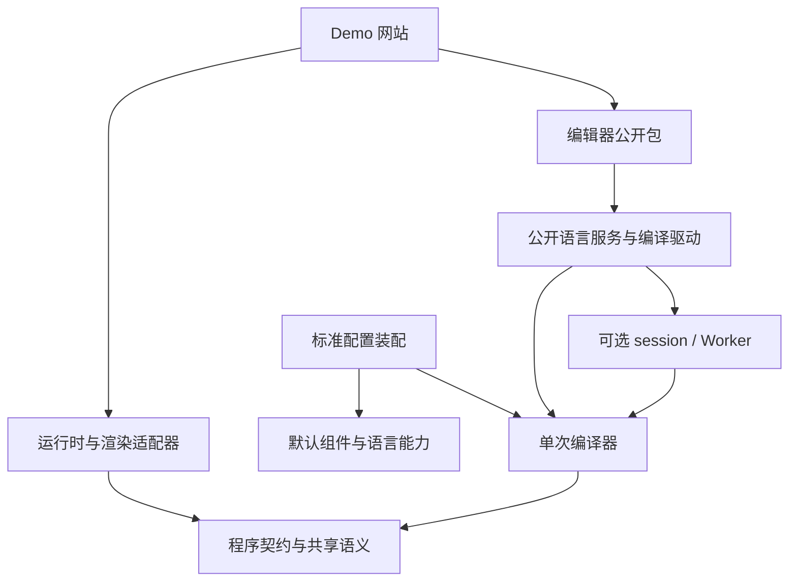

# ReactiveMD 近期规划：编译内核、宽松恢复与仓库拆分

更新日期：2026-11-06。任务 1 已提交为 8540086；任务 2 已提交并推送为 eeea87e；任务 3 已完成公开包消费验证，进入三仓库历史与目录迁移。引擎候选版本 0.8.0-next.0，编辑器 0.1.0-next.0，Demo 0.1.0；均未执行 npm 发布或站点部署。

本文合并原《精简编译内核与可选能力架构设计》，并收拢原长期路线图中与本轮有关的任务。本文是本轮实施规则的唯一维护位置；已实现入口见第 6.1 节，其他新增类型、恢复行为和仓库名称仍为目标设计。实施者从第 1 节进入，按第 6 节逐阶段交付。

## 1. 快速接手

### 1.1 本轮要交付什么

1. 独立的单次编译入口：不加载编辑会话、Worker、React 或主题，也能完成编译。
2. 公开 `strict` 选项：严格模式保留现有行为；宽松模式局部恢复 HTML，将结构不完整的 RMD 片段降级为文本，继续渲染范围外的文章。
3. 语言引擎、编辑器、Demo 三个独立仓库：先验证公开包边界，再迁移仓库，分别维护版本与发布流程。

本轮保留旧 API 和默认行为。暂缓任意编译插件系统、组件市场、VS Code 扩展、主题协议升级及完整 Program 重写；这些后续方向见第 9 节。

### 1.2 首次接手的阅读顺序

先核对实际 checkout、HEAD、工作区改动和本目录规划，再沿下表定位本次任务。文件中的函数名比本文记录的行号更适合作为长期入口。

| 要理解的部分 | 优先阅读 | 需要回答的问题 |
| --- | --- | --- |
| 编译全链路 | [compiler-core.ts](../../src/local/compiler-core.ts)：`compileLocalCore`；[兼容门面](../../src/local/compiler.ts)：`compileLocalInternal`、`LocalCompilerServices`；[types.ts](../../src/local/types.ts)：`LocalCompileOptions`、`LocalCompileResult` | 输入在哪里校验，解析错误如何汇总，何时产出可执行文档？ |
| 标签与恢复 | [parser-core.ts](../../src/local/parser-core.ts)：`region`、`htmlCloseEnd`、`htmlLiteralEnd`、`convert`；[source-context.ts](../../src/local/source-context.ts) | 如何保护代码，如何确定组件范围，缺少闭合时读到了哪里？ |
| 配置与扩展 | [options-core.ts](../../src/local/options-core.ts)：`readCompilerOptions`、`readOptionCheck`；[options.ts](../../src/local/options.ts)：兼容配置与身份；[语义配置](../../src/sdk/compiler-config.ts)、[SDK config](../../src/sdk/config.ts) | 默认预设如何进入编译器，哪些配置真正影响语义？ |
| 连续编辑 | [incremental.ts](../../src/local/incremental.ts)、[parse-session.ts](../../src/local/parse-session.ts)、[compiler-cache.ts](../../src/local/compiler-cache.ts)、[worker.ts](../../src/local/worker.ts) | 哪些是优化，源码修订、完整帧与补丁如何对应？ |
| 运行与呈现 | [runtime.ts](../../src/local/runtime.ts)、[retention.ts](../../src/local/retention.ts)、[React 入口](../../src/react/index.ts) | 参数如何更新，换源码时如何迁移状态，如何渲染惰性文本？ |
| 编辑器与 Demo | [工具栏](../../src/editor/editor-toolbar.tsx)、[编辑器 Worker](../../src/editor/codemirror/analysis-worker.ts)、[Demo 配置](../../demo/extensions.ts)、[Demo 依赖](../../demo/package.json) | 哪些内部导入必须改为公开服务，组件与 CSS 在哪里装配？ |
| 打包与验收 | [package.json](../../package.json)、[库构建配置](../../vite.lib.config.ts)、[包检查](../../scripts/verify-package.mjs)、[消费检查](../../scripts/verify-packed.mjs) | 运行时代码和类型声明最终依赖了什么？ |

在项目根目录先执行只读定位：

```powershell
git status --short
git rev-parse HEAD
rg -n 'compileLocalInternal|LocalCompilerServices' src/local/compiler.ts
rg -n 'local.tag.unclosed|local.tag.mismatch|htmlLiteralEnd' src/local/parser-core.ts
rg -n 'localCompileOptionsKey|readLocalCompileOptions' src/local/options.ts
```

随后运行负责模块的现有测试，记录基线结果，再添加行为用例。当前 Demo 依赖 `file:..`，编辑器存在对 `src/local` 的相对导入；当前公开选项没有 `strict`。这些是待迁移现状，不能当作目标已经完成的证据。

## 2. 目标架构与仓库边界

### 2.1 三个仓库

| 目标仓库 | 维护内容 | 依赖与交付 |
| --- | --- | --- |
| `ReactiveMD`，语言引擎 | 编译器、底层契约、表达式语义、运行时、SDK、预设、React/SSR/standalone、导出；session、语言服务及通用 Worker | 先保留 `reactive-md` 多入口发行；核心入口独立。内部模块统一版本，库可单独安装和验证。 |
| `ReactiveMD-Editor` | CodeMirror、工具栏、补全与诊断呈现、源码导航、编辑/预览布局、编辑器专属 Worker 入口 | 独立编辑器包，仅使用引擎公开入口。引擎和 React 的兼容范围通过 peer dependencies 与消费测试表达。 |
| `ReactiveMD-Demo` | 示例文章、网站导航、场景展示、扩展装配、静态资产和部署 | 独立网站，通过锁文件固定引擎、编辑器和组件包的实际版本。 |

仓库名和编辑器包名在迁移阶段核对可用性；名称不阻塞模块实现。引擎仓库内部保留运行时和渲染适配器，使阅读器、SSR 和导出可以脱离编辑器使用。增量和语言服务与编译器共同维护，避免独立编辑器依赖编译器私有 ABI。



箭头表示依赖。Demo 可直接调用引擎公开入口；引擎和编辑器均不依赖 Demo。

### 2.2 内核与可选模块

| 层 | 职责与规则 |
| --- | --- |
| `contracts`、`semantics` | 程序、范围、诊断、组件语义声明、表达式和值规则。底层类型不从功能 barrel 反向导入。 |
| `compiler` | 单次解析、恢复、属性与结构校验、声明与绑定、表达式、循环和初值检查、普通数据结果。必需预算始终执行。 |
| `features`、`checks` | GFM、limited HTML、数学能力显式安装；KaTeX 显示预检可选，表达式语义检查始终保留。 |
| `session`、`worker`、`transport` | 跨次缓存、增量、调度、完整帧与可选补丁。关闭优化后使用同一语义流程。 |
| `runtime`、`retention` | runtime 运行稳定 Program；retention 负责源码变更后的状态迁移与采用事务。 |
| `authoring`、`analysis` | 语言分析、补全、重命名等无 UI 服务；渲染依赖索引为可选派生数据。 |
| SDK、预设及宿主适配器 | 装配组件实现、主题、作者信息、React、导出及构建能力。旧 API 通过兼容门面继续工作。 |

compiler 不导入 session、Worker、React、DOM、CSS、Vite 或 Node 文件系统。runtime 不导入 compiler/parser。单次编译不创建运行时、定时器或跨源码缓存；不可变的 registry 可以复用。

CommonMark 基础正文、RMD 词法、源码范围、通用语义和资源预算属于内核。最小入口默认无组件，standard 装配现有默认组件及完整语言能力。关闭一种语言能力会改变文档含义，必须记录到语义配置；关闭一种执行优化只能改变成本。

先改变依赖方向，再搬文件。按 `compiler/source`、`frontend`、`passes`、`emit` 分离阶段；第一方优化使用不公开导出的 `compiler/internal` 小型服务协议。核心不引用具体缓存类，也不开放任意插件重写 pass 的公共接口。

### 2.3 必须解除的现有耦合

| 当前位置 | 实施动作 |
| --- | --- |
| `compiler.ts`、`parser.ts` | 提取统一参考流程与恢复边界；阶段拆分保持单一属性、绑定和表达式校验实现。 |
| `options.ts`、`sdk/config.ts` | 将纯语义 descriptor 与 React、CSS、作者资源分开；默认预设由 standard 装配。 |
| `markdown-blocks.ts` | Lezer 块规划归入优化策略；参考解析路径独立，必须验证 Markdown 等价性和性能。 |
| `math-display.ts` | KaTeX 预检移到可选检查；standard 保持现有预检与诊断。 |
| `worker.ts`、`incremental.ts` | 分离驱动、会话、调度、作者分析、传输；Worker 可只运行单次编译。 |
| `runtime.ts`、`dependencies.ts` | 状态采用交给 retention；计算依赖留在语义层，重绘索引成为派生产物。 |
| `compiled-data.ts` | 核心直接构造普通数据；首轮通过适配器复用现有文档模型，逐步去除发布时转换。 |

## 3. 编译接口与结果契约

### 3.1 配置与调用

拟议公开调用：

```ts
import { createStandardCompiler } from 'reactive-md/compiler/standard';

const compiler = createStandardCompiler({ strict: false });
const result = compiler.compile(source);
```

`reactive-md/compiler` 提供最小工厂；standard 提供完整体验。两者以及旧入口的 `strict` 默认均为 `true`。Demo 阅读和实时预览显式选择 `false`，严格检查作为作者操作提供；导出携带所选模式和实际源码修订。

选项读取接受 boolean；缺省或 `undefined` 按 `true` 处理，其他值返回配置错误。配置身份按生效值归一化，使省略 strict 与显式 `true` 等价。同步、session、Worker、作者分析和导出均传递该选项。

`CompilerDescriptor` 保存语法/程序版本、组件语义、能力 id/version、strict、Markdown 行为和预算。`HostAssets` 保存 React 实现、主题 CSS、字体、作者菜单及导出资源。主题变化不触发重编译；影响编译含义的组件属性必须参与语义摘要。宿主工厂从同一配置生成编译、运行和呈现配置。

配置错误在工厂创建时返回结构化错误或抛出专用配置异常；作者源码错误通过编译结果返回。内部异常保留失败性质，不能伪装成恢复成功。

### 3.2 结果模型

拟议类型以以下行为契约为准，字段在 M0 固定：

```ts
type CompileResult =
  | {
      status: 'valid' | 'recovered';
      program: Readonly<Program>;
      diagnostics: readonly Diagnostic[];
      recoveries: readonly Recovery[];
      checks: CheckCoverage;
    }
  | {
      status: 'failed';
      diagnostics: readonly Diagnostic[];
      recoveries: readonly Recovery[];
    };

interface Recovery {
  code: string;
  causeRange: SourceRange;
  affectedRange: SourceRange;
  action: 'html-repair' | 'literal-fallback';
  boundary: 'token' | 'fragment' | 'container-end' | 'heading' | 'eof';
}
```

范围统一为原始源码 UTF-16 半开区间 `[start, end)`。`causeRange` 标记错误位置，`affectedRange` 标记实际恢复范围。恢复记录按范围与 code 稳定排序、去重；失败结果也可保留此前的恢复记录。

`valid` 无新增恢复动作，可以有原有 warning；`recovered` 有恢复动作且产出可执行程序；`failed` 无新程序。严格模式已有 fallback/warning 分类维持原样，不能因新增统计改变原有失败判断。`checks` 记录可选检查及其版本。

Program 包含源码与范围、正文/组件节点、声明、表达式、绑定、初值及所需运行能力，使用普通 record/array，深层只读并以迭代方式冻结。它不含 React、CSS、缓存、Worker 句柄或编辑会话修订。计算依赖和组件必需结构必须保留；可重建的渲染索引通过带源码、语义及程序摘要的旁路产物提供。

Program 首轮继续复用现有模型和适配器，不承诺长期持久化内部节点布局。持久保存源码和版本化参数。旧 `compileLocal` 保留 `ok/document/diagnostics`，新增恢复信息通过兼容字段或配套读取接口提供；不得在旧入口直接替换为新联合类型。

## 4. strict 与局部恢复的实现规则

### 4.1 行为矩阵

| 输入情况 | `strict: true` | `strict: false` |
| --- | --- | --- |
| 缺少 RMD 闭合、闭合标签错配、孤立结束标签 | 保留当前 error/warning 及范围 | 按下述范围规则输出惰性文本，记录 recovery |
| 局部原生 HTML 可恢复 | 保留现有处理 | 使用有上下文的 HTML 片段解析，转换为允许的节点 |
| HTML 边界不确定或超出支持范围 | 保留现有处理 | 降级受影响片段，继续范围外的正文 |
| 代码中的标签、已有普通文本 | 保留文本 | 保留文本，不生成恢复噪声 |
| 未注册标签 | 保留现有行为 | 保持惰性；当前会报结构错误的情形按恢复白名单处理 |
| 未知绑定、循环、非法初值、共享约束冲突 | 保留语义错误 | 保留语义错误 |
| 配置/版本/能力错误、预算超限 | 失败 | 失败 |

第一版白名单只处理标签结构问题。属性词法未结束，例如引号或 `>` 缺失，可降级但必须使用更保守的容器边界。组件属性类型、必填项和 leaf/container 形态约束继续按契约检查；扩展恢复类别时单独增加行为规则和用例。

静默表示恢复本身不弹窗、不插入正文错误块，也不批量生成 warning。恢复信息进入 `recoveries`，编辑器可在作者检查面板查看；已有无关 warning 继续保留。恢复后的程序仍须通过其余语义检查，才能返回 `recovered`。

若正常区域引用了降级片段内已被撤销的声明，该引用仍是未知绑定错误；首版不连带猜测或删除其依赖。“其余文章继续渲染”适用于可隔离的结构恢复，存在其他语义错误时仍返回 `failed`。

### 4.2 前端顺序与标签归属

1. 建立源码索引、预算和代码保护范围。围栏、行内代码、注释及 HTML 原始文本区域不能被当作 RMD 同步点。
2. 使用组件 registry 和原生 HTML 名称集合分类。已注册组件及其别名使用 RMD 规则；原生 HTML 使用 HTML 规则；未知标签保持惰性。注册冲突在配置阶段拒绝，不随扫描顺序改变归属。
3. 在收集语义声明之前完成结构恢复。被降级区域内的组件、插值、绑定和计算不进入后续语义 pass。
4. 以 `source.slice(start, end)` 形成不可再次解析的文本节点。渲染器转义显示，同一源码与配置下的导出和增量复用保持其惰性，源码不回写。源码或相关边界变化后重新判定；补全闭合标签可以恢复正常组件。

### 4.3 RMD 恢复范围

恢复范围由统一前端产生，全量和增量共用。实现使用以下顺序，不在文件尾补 RMD 闭合标签：

1. 正常闭合优先。在当前可靠外层边界内存在合法配对时，按完整组件解析，内部标题和空行均属于组件内容。
2. 孤立结束标签仅将该标签转为文本。遇到可匹配外层容器的结束标签时，将中间未闭合的内层片段降级，保留结束标签供外层完成闭合。
3. 未找到合法配对时，若起始标签词法完整，首版允许在后续 ATX 标题前重新同步：标题前有空行、处于相同 Markdown 容器上下文，并且位于代码、注释、HTML 原始文本和未结束属性引号之外。恢复规则暂时忽略失败 RMD 容器自身的嵌套层级；标题从新区域开始正常解析。
4. 空行、普通段落和看似完整的兄弟组件本身均不是同步点。未满足标题条件时，降级到最近可靠外层边界；没有外层边界时到 EOF。词法不完整的起始标签也采用此保守规则。
5. 合并重叠的降级区间，撤销其内部暂建节点和诊断，保留预算、版本等不可恢复失败。扫描和匹配必须消耗统一预算，避免对每个未闭合标签重复扫描全文。

第 3 条是本轮选定的恢复约定，M0 将其固定为测试；后续修改需要同步更新恢复策略版本和缓存身份。

例如，未闭合 `<alert>` 后有符合条件的同层标题时：

```md
前文正常渲染。

<alert>
这段显示为源码文本。

## 后续章节

后文继续按 Markdown/RMD 渲染。
```

降级范围从 `<alert>` 起到标题前；片段内部即使出现合法组件或插值，也保持文本。若文件后面有合法 `</alert>`，应优先保持完整组件，其内部标题不能触发该恢复。没有可靠同步点时，后续文字仍可读，但降级范围内的 Markdown 样式和交互均不激活。

### 4.4 HTML 局部恢复

HTML 的可省略标签和错配修复使用 [HTML 片段解析规则](https://html.spec.whatwg.org/multipage/parsing.html#parsing-html-fragments)。复用现有 parse5 依赖，但由 RMD 前端先确定输入片段和上下文，例如 table/tbody/tr；不能把剩余全文直接交给 HTML 解析器。

片段边界来自受保护的 Markdown/HTML 块范围或已配对外层结构。树重排、隐式闭合及补出的节点都限制在该片段内。无法隔离时输出惰性文本；原始文本元素不能按普通标题规则提前结束。正常 HTML 可省略标签不自动计为错误，仅实际触发本项目恢复策略时记录 recovery。

恢复后的树继续经过现有元素、属性和 URL 策略。`strict: false` 不启用脚本、CSS 或扩展 HTML 能力。补出的节点记录来源边界/合成标记，不能虚构原始标签偏移。混合 RMD 内容通过前端的明确边界处理；无法保留组件归属与范围时，将混合片段降级，禁止由 HTML 修复过程激活其中的交互。

整篇 HTML 继续通过独立 HTML 适配路径处理；目标入口为 `reactive-md/html`，产物与 RMD Program 区分。旧 `enableCss` 等选项由兼容层转发。

## 5. 会话、Worker 与状态一致性

- `strict`、恢复策略版本、HTML 策略、语法/程序/能力版本、组件语义、Markdown 行为、预算和源码参与语义身份。切换这些配置时使缓存、Worker 基线和派生索引失效；显示恢复面板不影响编译身份。
- 缓存只复用同一 pass 的结果。命中与未命中执行等价的语义预算；缓存容量是执行配置，不能帮助文档绕过节点、深度和表达式限制。
- session 接受 UTF-16 有序、不重叠的基准修订编辑；基准不匹配返回重新同步请求。分别记录当前源码修订和最近成功程序修订，失败编辑也推进源码修订。
- Worker 依赖编译驱动协议，可以选择单次或 session 驱动。握手验证 descriptor、程序及传输协议；每条结果、诊断和恢复记录所属帧带源码修订，宿主丢弃过时结果。
- 完整帧是基础传输，深层数据必要时使用扁平帧；补丁为可选优化。补丁失败最多请求一次完整帧，版本不兼容和预算拒绝直接报告失败。
- 同步编译取消只保证不发布旧结果；真正中止依靠 Worker 终止或后续协作执行器。超时、取消与语言错误分别表达。
- retention 先检查迁移兼容性，再原子切换程序与订阅。失败时保留旧运行时；旧预览必须标记未同步，导出只使用明确的源码修订与模式。runtime 的 reset 保持现有语义。

## 6. 分阶段路线图

按依赖推进，不预设日历工期。任务 1 已提交，任务 2 的恢复契约用例与实现已落地；M1 的独立 runtime 入口和进一步阶段拆分，以及 M3–M6 的后续宿主与迁仓工作仍待推进。完成时记录实际 commit、验证命令和证据。M0 → M1 → M2 → M3 → M4 → M5 → M6 为推荐交付顺序，代码搬迁服从行为基线。

| 阶段 | 任务与主要落点 | 可审查交付及完成条件 |
| --- | --- | --- |
| M0：固定契约与基线 | 核对 `types/options/parser/compiler`，固定 strict 默认值、新旧结果适配、恢复白名单与标题同步规则；记录当前导入图和代表性能 | 严格模式正常/错误语料及范围快照；新增宽松行为用例先能揭示差异；列出失败基线与本轮责任。优先复现缺失 `</alert>`、外层闭合救回内层、后续标题、合法跨标题组件四类。 |
| M1：建立单次参考路径 | 提取 source/frontend/passes/emit 与底层契约；新增 compiler/runtime 入口，移除对具体缓存服务的要求；保留 standard/compat | 无 session 的编译通过严格语料；新入口可独立消费；现有根入口签名与默认诊断不变。此阶段记录尚未移走的 Lezer/KaTeX 等依赖，不提前宣称最终精简达标。 |
| M2：实现局部恢复 | 在统一前端落实第 4 节；贯通 `strict` 校验、配置键、Program/恢复结果、旧入口适配与文本渲染 | 恢复范围和惰性通过测试；范围外文章继续渲染；语义/配置/预算错误仍失败；严格模式基线不变。 |
| M3：贯通执行与宿主 | 拆 session/worker/transport、retention；更新可序列化选项；编辑器面板、预览、SSR 与导出消费同一模式和修订 | full/cached/incremental、同线程/Worker、full/patch 结果等价；模式切换不复用旧结果；恢复后补全闭合标签能正确恢复交互；旧预览和导出不冒充当前结果。 |
| M4：完成独立包边界 | 解除默认预设、主题、Lezer、KaTeX 隐藏依赖；在参考前端稳定后细拆语言能力；公开编辑器所需配置身份、驱动及语言服务；以 tarball 消费替换内部导入 | 核心运行与 `.d.ts` 无可选依赖；引擎和编辑器可分别构建，独立消费者通过。Demo 在迁仓前用实际打包产物完成演练，暂存的同仓编辑器包也必须经公开入口消费。 |
| M5：迁出 Demo | 提取网站源码、资产、脚本、锁文件、测试与部署流程；替换 `file:..`，使用已发布或固定候选包 | 新仓库干净安装、构建、桌面/手机交互及导出通过；引擎仓库保留最小宿主集成样例。核对新仓库文档中的相对路径和 CI 工作目录。 |
| M6：迁出编辑器并收口 | 提取编辑器源码、专属 Worker/构建配置、CSS、测试与集成文档；建立兼容矩阵、独立 CI；Demo 升级消费独立编辑器包 | 三仓库可独立发布；引擎 CI 无需检出 Demo 或编辑器完整源码；编辑器无需引擎内部文件；旧 editor 入口兼容适配或明确的版本迁移路径已经验证。 |

M4 是跨仓库迁移的前置门槛。实施中的候选包可以使用锁定 tarball；正式依赖使用版本范围和锁文件，发布前在干净目录从 registry 再验证。仓库迁移保留可追溯历史，先完成新仓库验收，再移除原维护位置，避免两份源码长期并行修改。

旧 `reactive-md/editor` 在兼容期需要继续可用。迁移时评估旧实现的过渡发行或桥接包，验证安装图不出现引擎与编辑器互相依赖的循环；不能为了转发入口让最小引擎重新安装整套编辑器。改变根入口、删除旧入口或默认语言行为时，单独安排有迁移说明的破坏性版本。

### 6.1 任务 1 的当前交付

2026-11-06，基于上述源码 commit 在当前工作区实现，未创建新提交、发包或部署。使用 4 路 Claude Code 分别处理编译器、语义配置、解析器、打包与测试，主代理负责接口、整合、检查与文档。

- 新增 `reactive-md/compiler` 的 `createCompiler(options?)` 和 `reactive-md/compiler/standard` 的 `createStandardCompiler(options?)`。最小入口默认无组件，standard 显式装配默认预设和数学显示预检。
- 解析与语义流程各保留一份实现，旧 `compileLocal`、编辑会话和 Worker 通过兼容门面复用它们。源码错误继续返回 `LocalCompileResult`；工厂配置错误抛 `CompilerConfigurationError`。`strict` 与新 Program 联合类型留给任务 2。
- 运行时导入图已排除编辑会话、Worker、React、主题实现和 CSS；工厂固定语义配置，编译不创建运行时或调度定时器。宿主主题资源不进入语义快照与配置身份。使用说明见[单次编译入口](../integration/compiler-ch.md)。

验证记录：`npm.cmd test -- --maxWorkers=4` 通过 151 个文件、1,990 项测试；`npm.cmd run typecheck`、库/编辑器/standalone 构建与声明生成通过；`npm.cmd run test:package`、`node scripts/verify-compiler-entry.mjs` 和 `npm.cmd run test:docs` 通过。默认并发全套测试中有一项别名语料测试超出 5 秒，单独复跑及限制 4 个 worker 的全套均通过，未修改其超时阈值。

本地 tarball 已在全新临时目录通过 `npm install --offline --omit=peer --ignore-scripts` 安装；仅安装引擎包，未安装 React。两个入口的实际编译和仅使用 ES2022 类型库的 NodeNext 消费通过，记录见 `artifacts/claude-task1/packed-consumer-report.json`。独立 Claude Code 只读审查未发现 P1/P2 缺陷；最小结果接入既有默认渲染器的配置身份差异已写入使用说明。

`artifacts/claude-task1/compiler-entry-report.json` 保存实际运行时和声明图、阻断模块的 ESM 检查及无 DOM 浏览器生产消费结果。`performance.json` 保存 Windows / Node 22.17.0 下 8,648 UTF-16 单元 Markdown 的 5 组独立进程原始样本，比较当前构建的最小、standard、兼容入口；它不是修改前性能基线。

M4 尚需拆分 Lezer、GFM、parse5 与默认组件回退依赖。KaTeX 随 standard 显示预检加载，最小生产入口的可达图中没有 KaTeX；两者的声明仍可达 SDK 主题协议类型。当前不宣称达到第 7.2 节的最终精简边界。

### 6.2 任务 2 的当前交付

在 `8540086` 上使用 6 路 Claude Code 并行实现，主代理整合。公开 `strict`，默认 true；宽松模式在语义收集前隔离不完整 RMD，并对局部 HTML 做 parse5 恢复。恢复保留 UTF-16 原始范围和惰性，语义、配置、版本及预算失败继续保留。新工厂提供 status/program/recoveries/checks，并保留 ok/document 读取方式；旧入口只在有恢复时附加 recoveries。Worker、会话、补丁、作者分析与导出传播相同模式。

details 使用共享的 summary/body 拆分，修复无空行时标题丢失；按单个 disclosure 的空标题 accordion 呈现。桌面 1280 和手机 375 宽度的折叠、键盘、嵌套、初始 open、HTML 修复及范围外控件交互已通过，见 `artifacts/tolerance/browser/report.json`。

已有全套 `npm.cmd test -- --maxWorkers=4` 通过 157 个文件、2,101 项测试；之后补充的原始 HTML 区域保护修复通过针对性回归。构建、类型、生产入口隔离、离线 tarball 安装及无 DOM 类型库的 NodeNext 消费通过。最后一轮追加全量/浏览器验证及独立只读审查，按用户“快点结束，不用做更多验证了”的要求停止，不宣称取得最终审查结论。记录位于 `artifacts/claude-task2/`；详细行为见[严格模式与局部恢复](../reference/tolerance-ch.md)。任务 2 随后提交并推送为 eeea87e，未执行 npm 发布或部署。

### 6.3 任务 3：独立仓库交付

语言引擎继续维护 ReactiveMD，编辑器迁至 [ReactiveMD-Editor](https://github.com/yao1145/ReactiveMD-Editor)，网站迁至 [ReactiveMD-Demo](https://github.com/yao1145/ReactiveMD-Demo)。本地工作目录以原 ReactiveMD 目录为容器，下面三个同名目录分别具有独立 .git、package.json、锁文件、AGENTS.md 与工作流。迁移通过 Git subtree 提取原编辑器和 Demo 历史，保留引擎完整历史；旧 linked worktrees 随主仓库路径修复。

引擎纯作者服务迁入 src/authoring；编辑器通过 reactive-md 与 reactive-md/authoring 消费引擎，Demo 通过实际 tarball 安装两者。导出 CSS、notice、元数据和独立 HTML runtime 均通过公开 exports 读取。候选包文件名包含 SHA256 前缀，锁文件记录完整 integrity；不使用相邻源码链接。版本兼容矩阵、导入迁移和候选更新流程见[三仓库迁移](../integration/repository-split-ch.md)。

旧 editor 子路径采用明确的 0.8 破坏性迁移：已发布的 0.7 保持旧 API，新候选改用 reactive-md-editor，不建立引擎与编辑器互相依赖的转发循环。任务 1 中尚未完成的 Lezer/GFM/parse5 可选能力进一步精简继续列为后续工作；本次仓库拆分不把它们标为完成。

验证基线：引擎类型、构建和 119 个测试文件 / 1,704 项回归通过；编辑器类型、构建和 4 个文件 / 35 项回归通过。两包的实际 tarball 均在独立临时消费者完成安装、SSR/公开入口和 NodeNext 声明检查。Demo 独立构建通过；桌面 1440 / 手机 390 的参数联动、源码编辑后 Worker/预览更新、真实 HTML 导出及离线打开通过。删减 Demo 重复的引擎命令、目录和调度测试后保留网站自身回归。旧阶段验收和浏览器矩阵已移除，CI 各保留一个 Node24 必要验证作业；手动 npm OIDC 和站点产物工作流分别维护。迁移记录保留于工作容器 artifacts/claude-task3。

## 7. 验证与完成标准

### 7.1 按修改范围选测试

| 范围 | 现有测试/脚本入口 | 本轮新增断言 |
| --- | --- | --- |
| 解析与选项 | `tests/local-parser.test.ts`、`local-compile-options.test.ts`、`rmd-recovery.test.ts`、`parse-budget.test.ts` | strict 默认/非法值、恢复范围、Unicode/CRLF、代码保护、深嵌套、无可靠边界、不可恢复错误 |
| HTML | `tests/html-fallback-contract.test.ts`、`html-source-fallback.test.tsx`、`html-table.test.tsx` | 可省略标签、错配、表格上下文、局部树重排、混合 RMD 惰性及合成节点范围 |
| 增量与 Worker | `tests/local-incremental.test.ts`、`local-compile-worker.test.ts`、`deep-worker.test.ts`、`compiler-cache.test.ts` | 模式切换、乱序、失败修订、完整/补丁帧、恢复边界前后插删和新闭合标签 |
| 运行与呈现 | `tests/local-retention.test.ts`、`runtime-document-update.test.ts`、`local-renderer.test.tsx`、`sdk-server.test.tsx` | 降级区域不执行，范围外组件行为不变，迁移/reset 正确，SSR 与客户端一致 |
| 打包与迁仓 | `scripts/verify-package.mjs`、`verify-packed.mjs`、`verify-sdk-consumer.mjs`，编辑器与 Demo 构建 | Node 无 React/DOM 的最小消费、浏览器无 Node builtins、类型可达图、CSS、单实例 SDK 与外部组件 |

示例命令在项目根目录执行；其余测试按上表增加，迁仓后同步更新脚本位置：

```powershell
npm.cmd test -- tests/local-parser.test.ts tests/local-compile-options.test.ts tests/parse-budget.test.ts
npm.cmd test -- tests/local-incremental.test.ts tests/local-compile-worker.test.ts tests/deep-worker.test.ts
npm.cmd run test:docs
```

### 7.2 四项最终门槛

1. **语义一致。** 全量、缓存、增量及 Worker 重建结果具有相同状态、诊断码/级别/范围、恢复动作、绑定、初值、约束和读者交互。节点 id、对象身份和耗时不参与比较；可选检查集合相同时才比较其诊断。
2. **模块隔离。** 同时检查运行时导入、共享 chunk 和 `.d.ts`。最小入口无 CodeMirror、Lezer 增量、KaTeX、React、ELK、Vite 或主题；parse5 仅随 HTML 能力加载。验证直接 ESM import 和生产构建，不能只依据 tree shaking 配置。
3. **实际消费。** 编译和呈现使用同源组件配置，宿主显式加载 CSS；外部组件、别名、主题、SSR、standalone 和离线导出通过真实安装包验证。三仓库按支持矩阵测试兼容组合，Demo 锁定一个精确组合。
4. **性能与可靠性。** 同源码、同能力测量单次/编辑路径的冷启动、耗时和内存，保留环境及原始数据。关闭补丁仍支持内核允许的深度；缓存不绕预算；代表文档不得出现未解释的性能退化。

文档修改只检查内容、diff 和链接。实现期间按阶段运行相关检查；正式 npm 发布执行完整发布门禁，Demo 部署另行验收。操作步骤以根目录 [AGENTS.md](../../AGENTS.md) 和[发布文档](../development/releasing-ch.md)为准，本文不复制发布命令。

## 8. 交接、失败处理与维护规则

每个阶段的交付说明记录：完成项、实际源码 commit、公开接口变化、测试命令与结果、构建/依赖图证据、已知差异及下一个具体入口。任务涉及多个模块时，写明各模块负责者和共享接口负责人，防止编译、Worker、编辑器分别定义结果结构。

接手者的第一项实现应是 M0 的四组恢复对照用例，随后检查 `readLocalCompileOptions` 与 `localCompileOptionsKey` 的传播路径。无需先通读全部渲染器和 Demo；遇到呈现或导出问题，再沿第 1 节对应入口扩展阅读。

阶段失败时保留最后通过的兼容路径。标准入口可以切回已验证编译实现，但必须与程序/会话协议匹配；宽松恢复有问题时宿主可临时切回 strict，明确告知该文档可能重新编译失败。仓库迁移失败则继续使用已锁定的旧包组合，不把未验证的新仓库接入生产。

进度表只在有证据时标完成。新增恢复行为先补规则与用例，再改实现；跨仓库公共接口变更同时更新兼容矩阵和消费样例。最终仓库/包名在 M5/M6 落地前确定，兼容桥的发行方式在 M4 完成前确定；这些事项不阻塞 M0–M3。

## 9. 后续方向与资料

原长期路线图的后续工作保留以下顺序；本轮优先级以 M0–M6 为准，原 12–18 个月时间表和前 30 天清单不再作为当前执行安排。

| 后续方向 | 启动条件与保留要求 |
| --- | --- |
| 主题与基础控件 | 引擎/宿主边界稳定后完善语义 token、文档作用域、低优先级覆盖、退出机制及明暗/键盘/窄屏/离线验证；普通控件能跟随主题。 |
| 日常作者工具 | 复用公开语言服务建设 VS Code、模板、保存与资源导入；浏览器与桌面编辑的预览、导出共享语义。自定义包只在可信项目环境加载。 |
| 场景与采用验证 | 用交互讲义、参数估算和技术说明验证完整创作任务，收集重复使用和独立宿主升级证据。 |
| 组件与主题目录 | 协议和公开消费稳定后建立精选目录；npm 分发，按精确版本展示验证记录，第三方预览隔离，目录不成为编译运行依赖。 |
| 1.0 与生态 | 分别管理包、作者语法、组件、主题和状态格式版本；稳定公开入口，维护迁移与历史语料。弃用周期依据真实升级经验确定。 |

云端同步、多人协作、开放市场、更多渲染器和 AI 写作由持续使用需求触发。现有可访问性、离线资源与扩展兼容检查继续随实现维护。

相关资料：[扩展 SDK](../integration/extension-sdk-ch.md)、[组件协议](../development/component-protocol-ch.md)、[主题协议](../reference/theme-protocol-ch.md)、[HTML 兼容](../reference/html-compatibility-ch.md)、[兼容与迁移](../compatibility/compatibility-ch.md)、[性能总览](../development/performance-overview-ch.md)、[一致性样例](../../examples/conformance/README.md)。性能资料中的历史结果仅作基线线索，实施时重新测量当前版本。
