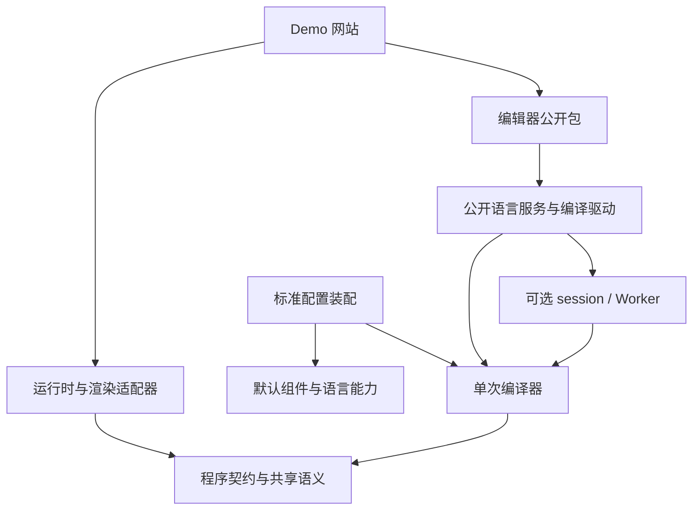

# ReactiveMD near-term plan: compiler kernel, local recovery and repository split

**English** · [中文](near-term-plan-ch.md)

Updated: 2026-11-06. Task 1 was committed as 8540086; task 2 was committed and pushed as eeea87e; task 3 completed public-package consumption verification, three-repository history extraction and local directory migration. Engine candidate version 0.8.0-next.0, editor 0.1.0-next.0, Demo 0.1.0; none has been published to npm or deployed to a site.

This document consolidates the original "lean compiler kernel and optional capability architecture design" and gathers the tasks relevant to this round from the original long-term roadmap. It is the sole maintenance location for this round's implementation rules; the actual one-shot compiler entry, recovery contract and repository split are in Section 6; further language capability trimming remains future design. Maintainers should first check the current code, then choose checks according to the scope of changes.

## 1. Quick start

### 1.1 What this round delivers

1. A standalone one-shot compilation entry: compilation completes without loading an editing session, Worker, React or theme.
2. A public `strict` option: strict mode keeps existing behavior; loose mode locally recovers HTML, downgrades structurally incomplete RMD fragments to text, and continues rendering the rest of the article.
3. Three independent repositories for the language engine, editor and Demo: first verify public package boundaries, then migrate repositories and maintain versions and release workflows separately.

This round keeps the old API and default behavior. It defers an arbitrary compilation plugin system, component marketplace, VS Code extension, theme protocol upgrade and full Program rewrite; these future directions are in Section 9.

### 1.2 Reading order for a first handover

First verify the actual checkout, HEAD, working-tree changes and the plan in this directory, then use the table below to locate the current task. Function names in the files are better long-term entry points than the line numbers recorded here.

| What to understand | Read first | Questions to answer |
| --- | --- | --- |
| Full compilation path | [compiler-core.ts](../../src/local/compilation/compiler-core.ts): `compileLocalCore`; [compatibility facade](../../src/local/compilation/compiler.ts): `compileLocalInternal`, `LocalCompilerServices`; [types.ts](../../src/local/contracts/types.ts): `LocalCompileOptions`, `LocalCompileResult` | Where is input validated, how are parse errors aggregated, and when is an executable document produced? |
| Tags and recovery | [parser-core.ts](../../src/local/parsing/parser-core.ts): `region`, `htmlCloseEnd`, `htmlLiteralEnd`, `convert`; [source-context.ts](../../src/local/source/source-context.ts) | How is code protected, how is component scope determined, and where does reading stop when a close is missing? |
| Configuration and extensions | [options-core.ts](../../src/local/configuration/options-core.ts): `readCompilerOptions`, `readOptionCheck`; [options.ts](../../src/local/configuration/options.ts): compatibility configuration and identity; [semantic configuration](../../src/sdk/compiler-config.ts), [SDK config](../../src/sdk/config.ts) | How does the default preset enter the compiler, and which configuration actually affects semantics? |
| Continuous editing | [incremental.ts](../../src/local/session/incremental.ts), [parse-session.ts](../../src/local/session/parse-session.ts), [compiler-cache.ts](../../src/local/session/compiler-cache.ts), [worker.ts](../../src/local/transport/worker.ts) | Which parts are optimizations, and how do source revisions, full frames and patches correspond? |
| Execution and presentation | [runtime.ts](../../src/local/runtime/runtime.ts), [retention.ts](../../src/local/runtime/retention.ts), [React entry](../../src/react/index.ts) | How are parameters updated, how is state migrated when the source changes, and how is literal text rendered? |
| Editor and Demo | [toolbar](../../src/editor/editor-toolbar.tsx), [editor Worker](../../src/editor/codemirror/analysis-worker.ts), [Demo configuration](../../demo/extensions.ts), [Demo dependencies](../../demo/package.json) | Which internal imports must become public services, and where are components and CSS assembled? |
| Packaging and acceptance | [package.json](../../package.json), [library build configuration](../../vite.lib.config.ts), [package check](../../scripts/verify-package.mjs), [consumption check](../../scripts/verify-packed.mjs) | What do runtime code and type declarations ultimately depend on? |

At the project root, first run read-only orientation:

```powershell
git status --short
git rev-parse HEAD
rg -n 'compileLocalInternal|LocalCompilerServices' src/local/compilation/compiler.ts
rg -n 'local.tag.unclosed|local.tag.mismatch|htmlLiteralEnd' src/local/parsing/parser-core.ts
rg -n 'localCompileOptionsKey|readLocalCompileOptions' src/local/configuration/options.ts
```

Then run the existing tests for the responsible module, record baseline results, and only then add behavior cases. The current Demo depends on `file:..`, and the editor has relative imports of `src/local`; current public options do not have `strict`. These are migration-status facts and cannot be taken as evidence that the target is complete.

## 2. Target architecture and repository boundaries

### 2.1 Three repositories

| Target repository | Maintained content | Dependencies and delivery |
| --- | --- | --- |
| `ReactiveMD`, language engine | Compiler, low-level contracts, expression semantics, runtime, SDK, presets, React/SSR/standalone, export; session, language services and general Worker | Initially keep the multi-entry `reactive-md` distribution; the core entry is independent. Internal modules share one version; the library can be installed and verified on its own. |
| `ReactiveMD-Editor` | CodeMirror, toolbar, completion and diagnostic presentation, source navigation, edit/preview layout, editor-specific Worker entry | Independent editor package that uses only public engine entries. Compatibility ranges for the engine and React are expressed through peer dependencies and consumption tests. |
| `ReactiveMD-Demo` | Example articles, site navigation, scenario demos, extension assembly, static assets and deployment | Independent website that pins actual versions of the engine, editor and component packages through its lockfile. |

Repository names and the editor package name are checked for availability during migration; names do not block module implementation. The engine repository keeps runtime and render adapters internally so readers, SSR and export can be used without the editor. Incremental compilation and language services are maintained alongside the compiler, avoiding an independent editor that depends on a private compiler ABI.



Arrows denote dependencies. The Demo may call public engine entries directly; neither the engine nor the editor depends on the Demo.

### 2.2 Kernel and optional modules

| Layer | Responsibilities and rules |
| --- | --- |
| `contracts`, `semantics` | Program, ranges, diagnostics, component semantic declarations, expression and value rules. Low-level types do not import back from feature barrels. |
| `compiler` | One-shot parsing, recovery, attribute and structure validation, declarations and bindings, expressions, cycles and initial-value checks, plain-data results. Required budgets always run. |
| `features`, `checks` | GFM, limited HTML and math capabilities are installed explicitly; the KaTeX display precheck is optional, and expression semantic checks always remain. |
| `session`, `worker`, `transport` | Cross-compilation caching, incremental compilation, scheduling, full frames and optional patches. Disabling optimizations uses the same semantic path. |
| `runtime`, `retention` | The runtime runs a stable Program; retention handles state migration and adoption transactions after source changes. |
| `authoring`, `analysis` | UI-free services such as language analysis, completion and rename; the render dependency index is optional derived data. |
| SDK, presets and host adapters | Assemble component implementations, themes, authoring metadata, React, export and build capabilities. Legacy APIs continue to work through a compatibility facade. |

The compiler does not import session, Worker, React, DOM, CSS, Vite or the Node filesystem. The runtime does not import the compiler/parser. One-shot compilation creates no runtime, timers or cross-source caches; immutable registries may be reused.

CommonMark baseline body text, RMD lexing, source ranges, common semantics and resource budgets belong to the kernel. The minimal entry has no components by default; standard assembles the existing default components and full language capabilities. Disabling a language capability changes document meaning and must be recorded in semantic configuration; disabling an execution optimization only changes cost.

Change dependency direction before moving files. Separate stages as `compiler/source`, `frontend`, `passes` and `emit`; first-party optimizations use a small non-exported `compiler/internal` service protocol. The core does not reference concrete cache classes or expose a public interface for arbitrary plugins to rewrite passes.

### 2.3 Existing coupling that must be removed

| Current location | Implementation action |
| --- | --- |
| `compiler.ts`, `parser.ts` | Extract a unified reference flow and recovery boundaries; stage separation keeps a single implementation of attribute, binding and expression validation. |
| `options.ts`, `sdk/config.ts` | Separate pure semantic descriptors from React, CSS and authoring assets; standard assembles the default preset. |
| `markdown-blocks.ts` | Move Lezer block planning into the optimization strategy; the reference parse path stays independent and must verify Markdown equivalence and performance. |
| `math-display.ts` | Move the KaTeX precheck into an optional check; standard keeps the existing precheck and diagnostics. |
| `worker.ts`, `incremental.ts` | Separate driver, session, scheduling, authoring analysis and transport; the Worker may run only one-shot compilation. |
| `runtime.ts`, `dependencies.ts` | Move state adoption to retention; keep computation dependencies in the semantic layer and make the redraw index a derived artifact. |
| `compiled-data.ts` | The core constructs plain data directly; the first round reuses the existing document model through an adapter and gradually removes publish-time conversion. |

## 3. Compiler interface and result contract

### 3.1 Configuration and invocation

Proposed public call:

```ts
import { createStandardCompiler } from 'reactive-md/compiler/standard';

const compiler = createStandardCompiler({ strict: false });
const result = compiler.compile(source);
```

`reactive-md/compiler` provides the minimal factory; standard provides the complete experience. Both, and the legacy entry, default `strict` to `true`. Demo reading and live preview explicitly choose `false`; strict checks are offered as an author action; export carries the selected mode and actual source revision.

Option reading accepts a boolean; omission or `undefined` is treated as `true`, and other values return a configuration error. Configuration identity is normalized by effective value, so omitting strict and explicitly setting `true` are equivalent. Sync, session, Worker, authoring analysis and export all pass this option.

`CompilerDescriptor` stores syntax/program versions, component semantics, capability id/version, strict, Markdown behavior and budgets. `HostAssets` stores React implementations, theme CSS, fonts, author menus and export assets. Theme changes do not trigger recompilation; component attributes that affect compilation meaning must participate in the semantic digest. The host factory produces compile, runtime and presentation configuration from the same configuration.

Configuration errors return a structured error or throw a dedicated configuration exception when the factory is created; author source errors return through the compile result. Internal exceptions preserve their failure nature and must not masquerade as successful recovery.

### 3.2 Result model

The proposed types follow these behavioral contracts; fields are fixed in M0:

```ts
type CompileResult =
  | {
      status: 'valid' | 'recovered';
      program: Readonly<Program>;
      diagnostics: readonly Diagnostic[];
      recoveries: readonly Recovery[];
      checks: CheckCoverage;
    }
  | {
      status: 'failed';
      diagnostics: readonly Diagnostic[];
      recoveries: readonly Recovery[];
    };

interface Recovery {
  code: string;
  causeRange: SourceRange;
  affectedRange: SourceRange;
  action: 'html-repair' | 'literal-fallback';
  boundary: 'token' | 'fragment' | 'container-end' | 'heading' | 'eof';
}
```

Ranges are uniformly UTF-16 half-open intervals `[start, end)` into the original source. `causeRange` marks the error location, and `affectedRange` marks the actual recovery range. Recovery records are stably sorted and deduplicated by range and code; a failed result may also retain earlier recovery records.

`valid` has no new recovery actions and may have existing warnings; `recovered` has recovery actions and produces an executable program; `failed` has no new program. Existing fallback/warning classifications in strict mode remain unchanged; new statistics must not change existing failure decisions. `checks` records optional checks and their versions.

Program contains source and ranges, body/component nodes, declarations, expressions, bindings, initial values and required runtime capabilities. It uses plain records/arrays, is deeply read-only, and is frozen iteratively. It contains no React, CSS, caches, Worker handles or editing-session revisions. Computation dependencies and component-required structure must be preserved; a rebuildable render index is provided as a side artifact carrying source, semantic and program digests.

For the first round, Program continues to reuse the existing model and adapter and does not promise a long-term persisted internal node layout. Persist source and versioned parameters. The legacy `compileLocal` keeps `ok/document/diagnostics`; new recovery information is provided through compatibility fields or a companion read interface; the old entry must not be directly replaced with the new union type.

## 4. Implementation rules for strict and local recovery

### 4.1 Behavior matrix

| Input condition | `strict: true` | `strict: false` |
| --- | --- | --- |
| Missing RMD close, mismatched closing tags, stray end tags | Keep current error/warning and ranges | Emit literal text according to the range rules below, and record a recovery and warning |
| Local native HTML is recoverable | Keep existing handling | Parse the HTML fragment with context and convert it to allowed nodes |
| HTML boundary is uncertain or outside supported scope | Keep existing handling | Downgrade the affected fragment and continue the body outside its range |
| Tags in code, existing ordinary text | Keep text | Keep text; generate no recovery noise |
| Unregistered tags | Keep existing behavior | Stay literal; cases that currently report structural errors follow the recovery allowlist |
| Unknown binding, cycle, invalid initial value, shared constraint conflict | Keep semantic error | Keep semantic error |
| Configuration/version/capability error, budget overflow | Fail | Fail |

The first-version allowlist handles only tag structure problems. Unterminated attribute lexing, such as a missing quote or `>`, may be downgraded but must use a more conservative container boundary. Component attribute types, required fields and leaf/container shape constraints continue to be checked per contract; extending recovery categories adds separate behavior rules and cases.

Successful local repairs are recorded in `recoveries` and emit at most one warning at each cause range, explaining the HTML repair or literal fallback. Recovery adds no inline error block. The diagnostic budget may omit excess warnings. Remaining semantic, configuration, version and budget failures stay errors; the program must pass those checks before returning `recovered`.

If a normal region references a declaration that was revoked inside a downgraded fragment, that reference remains an unknown-binding error; the first version does not guess or delete its dependencies. "The rest of the article continues rendering" applies to isolatable structural recovery; when other semantic errors exist, the result still returns `failed`.

### 4.2 Frontend order and tag ownership

1. Build the source index, budgets and code-protection ranges. Fences, inline code, comments and raw HTML text regions cannot be treated as RMD synchronization points.
2. Classify with the component registry and the set of native HTML names. Registered components and their aliases use RMD rules; native HTML uses HTML rules; unknown tags remain literal. Registration conflicts are rejected during configuration and do not change ownership with scan order.
3. Complete structural recovery before collecting semantic declarations. Components, interpolations, bindings and computations inside a downgraded region do not enter subsequent semantic passes.
4. Form a text node that cannot be parsed again from `source.slice(start, end)`. The renderer escapes it for display; export and incremental reuse under the same source and configuration remain literal; source is not written back. Re-evaluate after the source or relevant boundary changes; completing the closing tag can restore a normal component.

### 4.3 RMD recovery range

Recovery ranges are produced by the unified frontend and shared by full and incremental paths. The implementation uses the following order and does not append RMD closing tags at end of file:

1. Normal closure takes priority. When a valid pair exists within the current reliable outer boundary, parse as a complete component; internal headings and blank lines belong to the component body.
2. A stray closing tag becomes text by itself. On encountering the closing tag of a matchable outer container, downgrade the unclosed inner fragment in between and keep the closing tag for the outer container to close.
3. If no valid pair is found and the opening tag is lexically complete, the first version may resynchronize before a subsequent ATX heading: there is a blank line before the heading, the same Markdown container context applies, and the heading is outside code, comments, raw HTML text and unterminated attribute quotes. Recovery rules temporarily ignore the nesting level of the failed RMD container itself; the heading starts a new region and parses normally.
4. Blank lines, ordinary paragraphs and seemingly complete sibling components are not synchronization points by themselves. If the heading conditions are not met, downgrade to the nearest reliable outer boundary; if there is no outer boundary, downgrade to EOF. Lexically incomplete opening tags also use this conservative rule.
5. Merge overlapping downgrade ranges, revoke nodes and diagnostics tentatively built inside them, and retain non-recoverable failures such as budgets and versions. Scanning and matching must consume a unified budget, avoiding repeated full-text scans for each unclosed tag.

Item 3 is the recovery convention selected for this round; M0 fixes it as a test. Later changes require synchronously updating the recovery strategy version and cache identity.

For example, when an unclosed `<alert>` is followed by a qualifying heading at the same level:

```md
前文正常渲染。

<alert>
这段显示为源码文本。

## 后续章节

后文继续按 Markdown/RMD 渲染。
```

The downgrade range starts at `<alert>` and ends before the heading; even valid components or interpolations inside the fragment remain text. If a valid `</alert>` appears later in the file, the complete component should take priority, and internal headings must not trigger this recovery. Without a reliable synchronization point, later text remains readable, but Markdown styling and interaction inside the downgrade range are not activated.

### 4.4 Local HTML recovery

Omissible HTML tags and mismatch repair use the [HTML fragment parsing rules](https://html.spec.whatwg.org/multipage/parsing.html#parsing-html-fragments). Reuse the existing parse5 dependency, but the RMD frontend first determines the input fragment and context, such as table/tbody/tr; the remaining full text cannot be handed directly to the HTML parser.

Fragment boundaries come from protected Markdown/HTML block ranges or already-paired outer structures. Tree rearrangement, implicit closure and synthesized nodes are all confined to that fragment. If isolation is impossible, output literal text; raw-text elements must not end early under ordinary heading rules. Normally omissible HTML tags do not automatically count as errors; a recovery is recorded only when this project's recovery policy is actually triggered.

The recovered tree continues through the existing element, attribute and URL policies. `strict: false` grants no script, CSS or extended HTML capability. Synthesized nodes record their source boundary/synthetic marker and must not invent original tag offsets. Mixed RMD content is handled through explicit frontend boundaries; when component ownership and ranges cannot be preserved, downgrade the mixed fragment and prohibit HTML repair from activating interaction inside it.

Whole-document HTML continues through the separate HTML adapter path; the target entry is `reactive-md/html`, with output distinct from the RMD Program. Legacy options such as `enableCss` are forwarded by the compatibility layer.

## 5. Sessions, Workers and state consistency

- `strict`, recovery strategy version, HTML policy, syntax/program/capability versions, component semantics, Markdown behavior, budgets and source participate in semantic identity. Switching these configurations invalidates caches, Worker baselines and derived indexes; showing the recovery panel does not affect compile identity.
- Caches reuse results only for the same pass. Hits and misses execute equivalent semantic budgets; cache capacity is an execution configuration and cannot help a document bypass node, depth or expression limits.
- A session accepts UTF-16-ordered, non-overlapping edits against a base revision; a base mismatch returns a resynchronization request. Track the current source revision and the most recent successful program revision separately; failed edits also advance the source revision.
- Workers depend on the compile driver protocol and may choose one-shot or session driving. The handshake validates descriptor, program and transport protocol; every result, diagnostic and recovery record carries the source revision of its frame, and the host discards stale results.
- Full frames are the base transport; flat frames are used when necessary for deeply nested data; patches are an optional optimization. Patch failure requests a full frame at most once; version incompatibility and budget rejection report failure directly.
- Synchronous compile cancellation only guarantees that stale results are not published; actual abort relies on Worker termination or a later cooperative executor. Timeout, cancellation and language errors are expressed separately.
- Retention checks migration compatibility first, then atomically switches program and subscriptions. On failure it keeps the old runtime; the old preview must be marked unsynchronized, and export uses only an explicit source revision and mode. Runtime reset keeps its existing semantics.

## 6. Phased roadmap

Proceed by dependency, without a preset calendar schedule. Task 1 is committed, and task 2's recovery contract cases and implementation have landed; M1's standalone runtime entry and further stage separation, plus subsequent host recovery presentation and language capability trimming, remain pending. Public package boundaries and repository migration were completed per Section 6.3. Record the actual commit, verification commands and evidence on completion. M0 → M1 → M2 → M3 → M4 → M5 → M6 is the recommended delivery order; code moves follow the behavior baseline.

| Phase | Tasks and main landing points | Reviewable delivery and completion criteria |
| --- | --- | --- |
| M0: Fix contracts and baseline | Check `types/options/parser/compiler`, fix the strict default, old/new result adaptation, recovery allowlist and heading synchronization rules; record the current import graph and representative performance | Strict-mode valid/error corpus and range snapshots; new loose behavior cases first reveal the difference; list failing baselines and this round's responsibilities. Prioritize reproducing four categories: missing `</alert>`, an outer close rescuing inner content, a subsequent heading, and a valid component crossing a heading. |
| M1: Establish the one-shot reference path | Extract source/frontend/passes/emit and low-level contracts; add compiler/runtime entries and remove requirements for a concrete cache service; retain standard/compat | Compilation without a session passes the strict corpus; the new entry can be consumed independently; existing root-entry signatures and default diagnostics are unchanged. Record dependencies not yet moved, such as Lezer/KaTeX, and do not claim final trimming is achieved early. |
| M2: Implement local recovery | Implement Section 4 in the unified frontend; connect `strict` validation, configuration keys, Program/recovery results, legacy-entry adaptation and text rendering | Recovery ranges and literal behavior pass tests; text outside the range continues rendering; semantic/configuration/budget errors still fail; the strict-mode baseline is unchanged. |
| M3: Connect execution and hosts | Split session/worker/transport and retention; update serializable options; editor panel, preview, SSR and export consume the same mode and revision | full/cached/incremental, same-thread/Worker and full/patch results are equivalent; mode switches do not reuse old results; completing a closing tag after recovery correctly restores interaction; old previews and exports do not masquerade as current results. |
| M4: Complete independent package boundaries | Remove hidden dependencies on default presets, themes, Lezer and KaTeX; split language capabilities further after the reference frontend stabilizes; expose configuration identity, driver and language services needed by the editor; replace internal imports with tarball consumption | Core runtime and `.d.ts` have no optional dependencies; engine and editor build separately and independent consumers pass. Before repository migration, the Demo drills with actual packaged artifacts; even a temporarily colocated editor package must be consumed through public entries. |
| M5: Migrate the Demo out | Extract website source, assets, scripts, lockfile, tests and deployment workflow; replace `file:..` with published or pinned candidate packages | The new repository passes clean install, build, desktop/mobile interaction and export; the engine repository retains a minimal host integration example. Check relative paths and CI working directories in the new repository's docs. |
| M6: Migrate the editor out and close out | Extract editor source, dedicated Worker/build configuration, CSS, tests and integration docs; establish a compatibility matrix and independent CI; Demo upgrades to consume the independent editor package | Three repositories can release independently; engine CI needs no checkout of full Demo or editor source; the editor needs no engine-internal files; the legacy editor entry either has a tested compatibility adapter or an explicit version migration path. |

M4 is the prerequisite gate for cross-repository migration. Candidate packages during implementation may use locked tarballs; formal dependencies use version ranges and lockfiles, and are re-verified from the registry in a clean directory before release. Repository migration preserves traceable history; complete new-repository acceptance before removing the original maintenance location, avoiding long-term parallel edits to two source trees.

The legacy `reactive-md/editor` must remain available during the compatibility period. During migration, evaluate a transitional release or bridge package for the old implementation and verify that the install graph has no circular dependency between engine and editor; the minimal engine must not reinstall the entire editor merely to forward an entry. Changing the root entry, deleting an old entry or changing default language behavior requires a separate breaking version with migration notes.

### 6.1 Current delivery for task 1

On 2026-11-06, implemented in the current working tree based on the source commit above, without creating a new commit, package or deployment. A 4-way Claude Code split handled the compiler, semantic configuration, parser, and packaging and tests; the main agent handled interfaces, integration, checks and documentation.

- Added `createCompiler(options?)` from `reactive-md/compiler` and `createStandardCompiler(options?)` from `reactive-md/compiler/standard`. The minimal entry has no components by default; standard explicitly assembles the default preset and math display precheck.
- Parsing and semantic flows each retain one implementation; the legacy `compileLocal`, editing sessions and Worker reuse them through a compatibility facade. Source errors continue to return `LocalCompileResult`; factory configuration errors throw `CompilerConfigurationError`. `strict` and the new Program union type are left for task 2.
- The runtime import graph excludes editing sessions, Worker, React, theme implementations and CSS; the factory fixes semantic configuration, and compilation creates no runtime or scheduling timers. Host theme resources do not enter the semantic snapshot or configuration identity. See [one-shot compilation](../integration/compiler-en.md) for usage.

Verification record: `npm.cmd test -- --maxWorkers=4` passed 151 files and 1,990 tests; `npm.cmd run typecheck`, library/editor/standalone builds and declaration generation passed; `npm.cmd run test:package`, `node scripts/verify-compiler-entry.mjs` and `npm.cmd run test:docs` passed. In the full suite at default concurrency, one alias corpus test exceeded 5 seconds; a standalone rerun and the full suite limited to 4 workers both passed, and its timeout threshold was not changed.

The local tarball was installed in a fresh temporary directory with `npm install --offline --omit=peer --ignore-scripts`; only the engine package was installed, not React. Actual compilation through both entries and NodeNext consumption using only the ES2022 type library passed; the record is in `artifacts/claude-task1/packed-consumer-report.json`. An independent Claude Code read-only review found no P1/P2 defects; the configuration identity difference when the minimal result is connected to the existing default renderer is documented in the usage notes.

`artifacts/claude-task1/compiler-entry-report.json` stores the actual runtime and declaration graphs, the ESM check for blocked modules, and production consumption without a DOM browser. `performance.json` stores raw samples from 5 independent processes on Windows / Node 22.17.0 for 8,648 UTF-16 units of Markdown, comparing the current build's minimal, standard and compatibility entries; it is not a pre-change performance baseline.

M4 still needs to split Lezer, GFM, parse5 and default-component fallback dependencies. KaTeX loads with the standard display precheck and is not in the reachable graph of the minimal production entry; declarations for both are still reachable through SDK theme protocol types. The current work does not claim to reach the final trimming boundary in Section 7.2.

### 6.2 Current delivery for task 2

Implemented on `8540086` with 6 parallel Claude Code tracks and integrated by the main agent. Public `strict`, default true; loose mode isolates incomplete RMD before semantic collection and performs parse5 recovery for local HTML. Recovery preserves original UTF-16 ranges and literal behavior; semantic, configuration, version and budget failures still remain. The new factory provides status/program/recoveries/checks and retains ok/document reading; the legacy entry attaches recoveries only when present. Worker, session, patches, authoring analysis and export propagate the same mode.

details uses a shared summary/body split, fixing heading loss when there is no blank line; an accordion with an empty title is presented as a single disclosure. Folding, keyboard, nesting, initial open, HTML repair and out-of-range control interaction at desktop 1280 and phone 375 widths passed; see `artifacts/tolerance/browser/report.json`.

The existing full suite `npm.cmd test -- --maxWorkers=4` passed 157 files and 2,101 tests; a later fix protecting raw HTML regions passed targeted regression. Build, types, production-entry isolation, offline tarball install and NodeNext consumption without a DOM type library passed. The final round added full/browser verification and independent read-only review, and stopped at the user's request to "finish quickly, no more verification needed"; it does not claim a final review conclusion. Records are in `artifacts/claude-task2/`; detailed behavior is in [strict parsing and local recovery](../reference/tolerance-en.md). Task 2 was subsequently committed and pushed as eeea87e, without npm publication or deployment.

### 6.3 Task 3: independent repository delivery

The language engine continues as ReactiveMD, the editor moved to [ReactiveMD-Editor](https://github.com/yao1145/ReactiveMD-Editor), and the website moved to [ReactiveMD-Demo](https://github.com/yao1145/ReactiveMD-Demo). The local working directory uses the original ReactiveMD directory as a container, with three same-named directories below it, each with independent .git, package.json, lockfile, AGENTS.md and workflows. Migration extracts the original editor and Demo history through Git subtree and preserves the engine's full history; old linked worktrees were repaired along with the main repository path.

The engine's pure authoring services moved into src/authoring; the editor consumes the engine through reactive-md and reactive-md/authoring, and the Demo installs both through actual tarballs. Exported CSS, notices, metadata and the standalone HTML runtime are all read through public exports. Candidate package filenames include a SHA256 prefix, and lockfiles record full integrity; no adjacent source links are used. Version compatibility matrix, import migration and candidate update process are in [repository migration](../integration/repository-split-en.md).

The legacy editor subpath uses an explicit 0.8 breaking migration: published 0.7 keeps the old API, the new candidate uses reactive-md-editor, and no forwarding loop with mutual engine/editor dependency is established. Further trimming of optional Lezer/GFM/parse5 capabilities left incomplete in task 1 remains follow-up work; this repository split does not mark it complete.

Verification baseline: engine types, build and 119 test files / 1,704 regressions passed; editor types, build and 4 files / 35 regressions passed. Actual tarballs of both packages completed installation, SSR/public-entry and NodeNext declaration checks in independent temporary consumers. The Demo standalone build passed; parameter linkage at desktop 1440 / phone 390, Worker/preview updates after source edits, real HTML export and offline opening passed. After removing duplicated Demo engine commands, directories and scheduling tests, 20 files / 150 website-owned regressions passed. Independent builds in the three final repository directories and clean installs in the two consumer repositories passed. Old phase acceptance and browser matrices were removed; CI keeps one necessary Node24 verification job per repository; manual npm OIDC and site-artifact workflows are maintained separately. The new editor and Demo repositories are private. The migration record remains in the work container's artifacts/claude-task3.

## 7. Verification and completion criteria

### 7.1 Selecting tests by change scope

| Scope | Existing test/script entry | New assertions this round |
| --- | --- | --- |
| Parsing and options | `tests/local-parser.test.ts`, `local-compile-options.test.ts`, `rmd-recovery.test.ts`, `parse-budget.test.ts` | strict default/invalid values, recovery ranges, Unicode/CRLF, code protection, deep nesting, no reliable boundary, unrecoverable errors |
| HTML | `tests/html-fallback-contract.test.ts`, `html-source-fallback.test.tsx`, `html-table.test.tsx` | omissible tags, mismatches, table context, local tree rearrangement, mixed RMD literal behavior and synthetic node ranges |
| Incremental and Worker | `tests/local-incremental.test.ts`, `local-compile-worker.test.ts`, `deep-worker.test.ts`, `compiler-cache.test.ts` | mode switches, out-of-order input, failed revisions, full/patch frames, insertion/deletion around recovery boundaries and new closing tags |
| Runtime and presentation | `tests/local-retention.test.ts`, `runtime-document-update.test.ts`, `local-renderer.test.tsx`, `sdk-server.test.tsx` | downgraded regions do not execute, out-of-range components behave unchanged, migration/reset correct, SSR and client consistent |
| Packaging and migration | `scripts/verify-package.mjs`, `verify-packed.mjs`, `verify-sdk-consumer.mjs`, editor and Demo builds | minimal Node consumption without React/DOM, browser without Node builtins, type reachability graph, CSS, single-instance SDK and external components |

Example commands run at the project root; add other tests per the table above and update script locations after repository migration:

```powershell
npm.cmd test -- tests/local-parser.test.ts tests/local-compile-options.test.ts tests/parse-budget.test.ts
npm.cmd test -- tests/local-incremental.test.ts tests/local-compile-worker.test.ts tests/deep-worker.test.ts
npm.cmd run test:docs
```

### 7.2 Four final gates

1. **Semantic consistency.** Full, cached, incremental and Worker rebuild results have the same status, diagnostic codes/severity/ranges, recovery actions, bindings, initial values, constraints and reader interaction. Node ids, object identity and timing do not participate in comparison; optional-check diagnostics are compared only when their check sets match.
2. **Module isolation.** Check the runtime import, shared chunks and `.d.ts` together. The minimal entry has no CodeMirror, Lezer incremental, KaTeX, React, ELK, Vite or theme; parse5 loads only with the HTML capability. Verify direct ESM imports and production builds, not just tree-shaking configuration.
3. **Actual consumption.** Compilation and presentation use the same component configuration, and the host loads CSS explicitly. External components, aliases, themes, SSR, standalone and offline export are verified with actual installed packages. The three repositories test compatible combinations per the support matrix; the Demo pins one exact combination.
4. **Performance and reliability.** For the same source and capabilities, measure cold start, duration and memory for the one-shot/edit paths, preserving the environment and raw data. With patches disabled, the kernel's allowed depth is still supported; caches do not bypass budgets; representative documents show no unexplained performance regression.

Documentation changes only check content, diff and links. During implementation, run relevant checks per phase; formal npm release runs the full release gate, and Demo deployment is accepted separately. Operation steps follow the root [AGENTS.md](../../AGENTS.md) and [release documentation](../development/releasing-en.md); this document does not duplicate release commands.

## 8. Handover, failure handling and maintenance rules

Each phase's delivery notes record completed items, actual source commit, public interface changes, test commands and results, build/dependency-graph evidence, known differences and the next concrete entry point. When a task spans multiple modules, name the owner of each module and the owner of shared interfaces, preventing the compiler, Worker and editor from each defining their own result structure.

A new maintainer's first implementation should be the four recovery contrast cases in M0, then a check of the propagation paths for `readLocalCompileOptions` and `localCompileOptionsKey`. There is no need to read every renderer and the Demo first; when presentation or export issues arise, expand reading along the corresponding entries in Section 1.

On phase failure, keep the last passing compatibility path. The standard entry may switch back to a verified compiler implementation, but must match the program/session protocol; when loose recovery has issues, the host may temporarily switch back to strict and clearly state that the document may fail to recompile. If repository migration fails, continue using the locked old package combination and do not connect the unverified new repository to production.

Mark progress complete only when there is evidence. For new recovery behavior, add rules and cases before changing implementation; cross-repository public interface changes update the compatibility matrix and consumption examples together. Final repository/package names are decided before M5/M6, and the release form of compatibility bridges before M4; these do not block M0–M3.

## 9. Follow-up directions and references

The original long-term roadmap's follow-up work keeps the following order; this round's priorities are M0–M6, and the original 12–18 month schedule and first-30-days list are no longer the current execution plan.

| Follow-up direction | Start conditions and retained requirements |
| --- | --- |
| Themes and basic controls | After engine/host boundaries stabilize, improve semantic tokens, document scoping, low-priority overrides, exit mechanisms, and light/dark, keyboard, narrow-screen and offline verification; ordinary controls can follow the theme. |
| Daily authoring tools | Build VS Code, templates, save and asset import on public language services; browser and desktop editing previews and export share semantics. Custom packages load only in trusted project environments. |
| Scenario and adoption validation | Validate complete authoring tasks with interactive handouts, parameter estimates and technical notes, collecting evidence of repeated use and independent host upgrades. |
| Component and theme catalog | Establish a curated catalog after protocols and public consumption stabilize; distribute via npm, show verification records by exact version, isolate third-party previews, and keep the catalog out of compile/runtime dependencies. |
| 1.0 and ecosystem | Manage versions separately for packages, authoring syntax, components, themes and state formats; stabilize public entries and maintain migration and historical corpora. Deprecation periods are based on real upgrade experience. |

Cloud sync, multi-user collaboration, an open marketplace, more renderers and AI writing are triggered by sustained usage needs. Existing accessibility, offline assets and extension compatibility checks continue to be maintained with implementation.

Related material: [extension SDK](../integration/extension-sdk-en.md), [component protocol](../development/component-protocol-en.md), [theme protocol](../reference/theme-protocol-en.md), [HTML compatibility](../reference/html-compatibility-en.md), [compatibility and migration](../compatibility/compatibility-en.md), [performance overview](../development/performance-overview-en.md), [conformance examples](../../examples/conformance/README.md). Historical performance results are baseline clues only; re-measure the current version during implementation.
