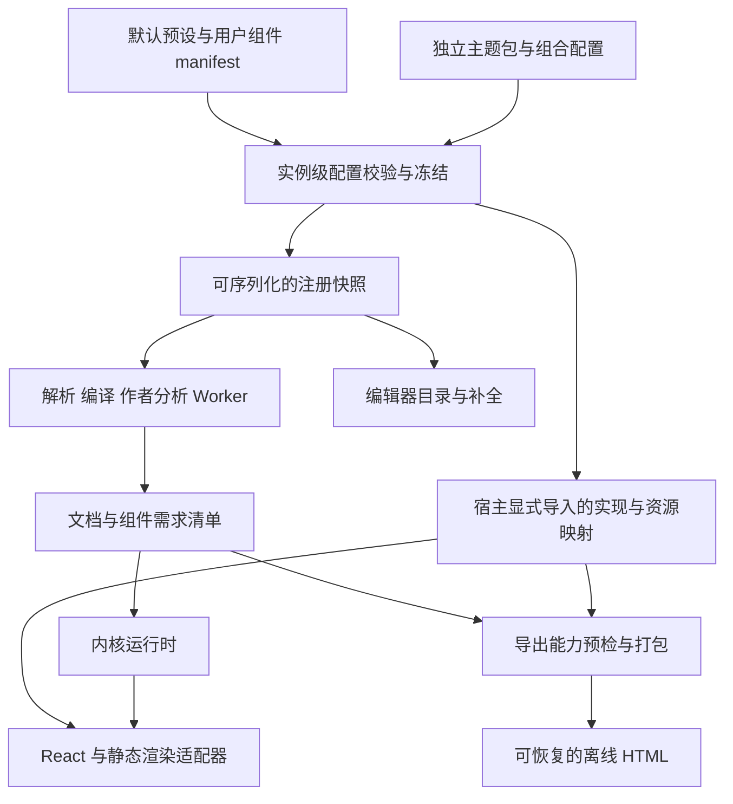

# 扩展 SDK 与组件统一架构规划

状态：三个阶段均已实施。日期：2026-10-30。交付与验证见[统一验收记录](extension-sdk-acceptance-ch.md)。SDK 使用源码构建的安装包预览，npm 发布单独安排。

本文保留最初的架构设计、源码基线与实施顺序。已交付的入口和契约以 [SDK 指南](../integration/extension-sdk-ch.md)为准，实际实现与结果汇入统一验收记录。

## 1. 架构目标与交付边界

稳定内核提供文档运行能力，内置组件和用户组件遵循同一套扩展协议，主题独立安装和组合。

开发者安装 npm 包后，应能在自己的项目里定义并注册组件，获得属性校验、响应式绑定、编辑器支持和声明过的渲染能力。开发过程只使用公开入口。内置组件也必须通过这些公开契约实现，这是本次架构工作的最终验收标准。

内核统一维护语法解析、表达式求值、依赖调度、状态与共享约束校验、资源预算和源码定位。组件提供功能、交互及表现；主题提供视觉变量和样式覆盖。Markdown 基础节点、`theme`、`computed`、`external` 等语言声明继续由内核处理。

本轮采用一个 npm 包、多个公开子入口。先完成实例级配置和扩展契约，再分批迁移内置组件，最后补齐编辑器与分享消费流程。发布版本、npm 发包和 Demo 部署按实际交付另行安排。

范围暂不包含组件市场、远程插件下载、文档内任意 JavaScript、第三方代码沙箱、运行中修改注册表，以及同名覆盖内置组件。组件代码由宿主主动安装和导入。

## 2. 源码基线与已有能力

用户提案基于 `7810d28`、`0.6.1`。本次检查的 HEAD 为 `984e93adf373d025fb1ca1fa7e49080902f484e9`，根包版本仍为 `0.6.1`。两者之间的提交只修改文档，以下架构判断适用于这两个提交的相关实现。

| 领域 | 已核对的现状 | 规划中的处理 |
| --- | --- | --- |
| 组件定义 | 内置使用 `LocalComponentSchema` 与冻结的 `LOCAL_COMPONENTS`；外部使用 `LocalHostComponentSchema` | 合并为统一定义，再由默认预设装配内置集合 |
| 解析与编译 | parser 有内置形态集合及宿主分支；compiler 分别解析内置绑定和宿主绑定 | 以注册快照驱动形态、属性、结构和绑定解析 |
| 绑定能力 | 宿主 schema 公开单个标量绑定；内核已有字符串数组、数字数组、命名槽位和 `setMany` | 将已有能力整理成组件上下文，逐步统一约束机制 |
| React 渲染 | 内置走 `COMPONENTS`，宿主走单个 `hostRenderer` | 按组件标识查找实现，统一实例上下文 |
| 属性值 | `resolveHostProp` 保留完整插值的标量类型，普通字面值通过 `runtime.text()` 返回文本 | 为新 SDK 建立按声明归一化的属性读取层 |
| 作者工具 | 已读取宿主 schema；闭合标签候选未加入宿主组件；插入目录分别维护 | 从定义生成候选、插入菜单和属性说明 |
| 主题 | 有 `LocalThemeDefinition`、协议校验、实例作用域、深浅模式和公共变量 | 增加包约定、显式组合及资源收集 |
| 导出 | `normalizeCompileOptions` 未保留宿主 schema；standalone 挂载选项没有宿主 renderer | 贯通编译配置、实现绑定和资源打包 |
| 隔离 | 宿主 renderer 当前捕获直接调用的同步异常 | 增加 React 子树异常、SSR 和异步任务各自的处理契约 |

本地依据：

- [schema.ts](https://github.com/yao1145/ReactiveMD/blob/7810d28/src/local/schema.ts)、[types.ts](https://github.com/yao1145/ReactiveMD/blob/7810d28/src/local/types.ts)、[options.ts](https://github.com/yao1145/ReactiveMD/blob/7810d28/src/local/options.ts)。
- [parser.ts](https://github.com/yao1145/ReactiveMD/blob/7810d28/src/local/parser.ts)、[compiler.ts](https://github.com/yao1145/ReactiveMD/blob/7810d28/src/local/compiler.ts)、[runtime.ts](https://github.com/yao1145/ReactiveMD/blob/7810d28/src/local/runtime.ts)。
- [渲染上下文](https://github.com/yao1145/ReactiveMD/blob/7810d28/src/local/render-types.ts)、[React 渲染器](https://github.com/yao1145/ReactiveMD/blob/7810d28/src/local/LocalDocumentView.tsx)。
- [作者分析与补全](https://github.com/yao1145/ReactiveMD/blob/7810d28/src/local/authoring.ts)、[编辑器目录](https://github.com/yao1145/ReactiveMD/blob/7810d28/src/editor/native-components.ts)、[Demo 目录](https://github.com/yao1145/ReactiveMD/blob/7810d28/demo/src/native-components.ts)。
- [HTML 导出](https://github.com/yao1145/ReactiveMD/blob/7810d28/src/shareable.ts)、[standalone 挂载](https://github.com/yao1145/ReactiveMD/blob/7810d28/src/standalone/session.tsx)、[Worker 协议](https://github.com/yao1145/ReactiveMD/blob/7810d28/src/local/worker.ts)。
- [宿主集成](../integration/local-integration-ch.md)、[现行组件协议](component-protocol-ch.md)、[现行主题协议](../reference/theme-protocol-ch.md)。

## 3. 路径选择

| 路径 | 收益 | 代价与适用范围 |
| --- | --- | --- |
| 推荐：统一注册模型，分批迁移 | 编译、状态、渲染与作者工具最终共用契约；每批可独立验证 | 初期需要整理 compiler 的特殊分支；迁移期间保留兼容适配 |
| 只封装现有 `hostComponents` 与 `hostRenderer` | 最快提供外部开发入口 | 仍有两套组件能力；适合作为短期兼容桥，不能作为终态 |
| 一次迁移全部内置并拆包 | 一次完成目录与依赖重组 | 同时改变编译、渲染、构建和消费路径，回归面过大 |

采用第一条路径。第一阶段可以复用宿主扩展底座，但新公共契约应直接表达目标能力；第二阶段逐项消除内置专用的注册、绑定和分发通道。

## 4. 目标结构与数据流



### 4.1 实例级配置

新增 `createLocalConfig` 一类的配置工厂，接收组件预设、用户组件和主题集合，校验后形成不可变配置。名字暂定，审核时确认。

配置分为两层：

1. 可序列化的注册快照，包含组件 manifest、主题元数据、协议要求及确定性的语义摘要。编译器、作者工具和 Worker 只接收这一层。
2. 宿主实现与资源映射，包含 React 实现、静态实现、CSS 和导出模块描述。它们由相应适配器持有，函数与 React 对象不进入 Worker 或文档载荷。

所有消费面从同一配置派生所需数据。普通编译仍可沿用 `compileLocal(source)` 的默认组件行为；高级宿主显式选择预设。配置创建后冻结，修改组件集合时创建新配置，并触发相应编译和能力预检。

编译结果记录所用组件的稳定标识、协议要求及语义摘要。渲染器在挂载前校验实现与编译结果匹配，防止使用 A 配置编译、B 配置渲染。组件摘要与整份配置缓存键分开：文档依赖只记录实际使用的组件，缓存则覆盖所有影响编译语义的配置。

主题配色或说明文字变化不应清空文档状态。组件语义配置变化需要重新编译，再按既有状态保留规则校验可复用的参数。

### 4.2 公开入口

| 入口提案 | 职责 | 依赖要求 |
| --- | --- | --- |
| `reactive-md` | 保留现有核心 API 与默认行为 | 保持 Node 可用、无 React 导入副作用 |
| `reactive-md/sdk` | 定义、manifest 校验、配置组合、公共上下文基础类型 | 纯数据和内核类型 |
| `reactive-md/presets/default` | 默认组件声明与默认预设描述 | schema 部分保持无 React |
| `reactive-md/react` | React 绑定工厂、默认实现与文档视图 | React 19；默认方便用法保留 |
| `reactive-md/authoring` | 从配置生成分析、补全和插入目录 | 继续支持无 React 的分析调用 |
| `reactive-md/testing` | manifest 与行为合规工具 | 重型测试适配依赖按需导入 |
| `reactive-md/export` | 宿主构建侧的组件资源收集与离线打包 | 浏览器载荷与 Node 打包依赖分离 |

后两个入口按阶段交付。阶段一先提供最小内部验证工具和宿主构建样例，阶段三再稳定通用公开接口。构建配置、声明生成和真实 tarball 消费测试同步覆盖新增入口。

`/sdk` 不转出 React 类型或 Node 打包器。默认预设的声明和实现分开导入；选择少量组件的宿主无需加载整套图形实现。具体按组件子入口在迁移阶段依据产物分析确定。

## 5. 可执行组件契约

### 5.1 定义与实现分离

组件由纯数据 manifest 和一个或多个适配器实现组成。组件稳定标识独立于源码标签名，推荐以包或组织命名空间加组件名表达；标签继续沿用现有小写 kebab-case。

| 声明项 | 内容 | 校验位置 |
| --- | --- | --- |
| 身份 | 稳定 id、标签名、实现版本、SDK 协议、兼容的内核版本范围 | 注册时 |
| 形态 | leaf、inline、container | 注册及解析时 |
| 属性 | 类型、默认值、必填、枚举、范围、静态或动态、说明 | 注册、编译及运行时求值 |
| 子项 | Markdown/inline 内容、允许的结构子项、数量与父项约束 | 编译时 |
| 绑定 | 槽位、类型、family、初值规则、约束来源、共享或独占 | 编译及运行时写入 |
| 能力 | 交互 DOM、静态、SSR、离线交互、所需环境与宿主服务 | 绑定实现及消费前 |
| 编辑器 | 多语言标题、说明、分类、模板、示例、属性帮助 | 注册及作者工具生成时 |
| 样式与资源 | 组件样式标识、主题变量要求、导出资源标识 | 构建及导出预检 |
| 依赖 | 其他组件的 id 与兼容版本范围 | 配置装配时 |

manifest 使用有界 JSON 数据；默认值同样接受类型和预算检查。禁止函数、循环引用、原型污染键及不受支持的正则模式。继续采用现有线性时间安全的 pattern 子集。

注册预算分别约束组件数量、属性与槽位数量、字符串长度、依赖深度和 manifest 总体积。默认预设和外部组件分项计数，再受统一总量限制；现有宿主最多 32 个 schema 的限制保留在旧接口中，不能直接套在包含全部内置组件的新配置上。编译与运行时继续执行文档预算，导出另设资源数量和总字节预算。

依赖由宿主提供的组件集合满足。缺失依赖、依赖环、重复 id、重复标签、协议不支持或版本不相容时，配置创建失败并列出路径。配置装配不访问 registry 或网络。

### 5.2 接口草图

以下展示调用关系，字段和函数名尚未实施；完整判别联合与泛型在阶段一收敛。

```ts
// 提案：纯数据 manifest 可独立进入 Worker。
const rating = defineLocalComponent({
  id: 'example/rating',
  name: 'rating',
  version: '1.0.0',
  protocol: 'reactive-md-component/v1',
  form: 'leaf',
  props: {
    label: { kind: 'string', required: true },
    max: { kind: 'number', dynamic: true, default: 5, min: 1, max: 10, integer: true },
  },
  bindings: {
    value: {
      kind: 'number', family: 'number',
      bind: 'bind', initial: 'initial',
      initialRule: 'nearest-zero',
      constraints: { min: { literal: 0 }, max: { prop: 'max' }, step: { literal: 1 } },
    },
  },
  capabilities: { interactive: true, static: true, ssr: true, offline: true },
  authoring: {
    title: { zh: '评分', en: 'Rating' },
    category: 'input',
    insertText: '<rating bind="score" label="评分" initial="3">',
  },
});

// 提案：React 类型只出现在 React 入口。
const ratingReact = defineReactComponent(rating, {
  render: RatingControl,
  renderStatic: RatingText,
});

const config = createLocalConfig({
  presets: [defaultPreset],
  components: [rating, hint],
  themes: [paperTheme],
});
const reactConfig = createReactConfig(config, {
  presets: [defaultReactPreset],
  components: [ratingReact, hintReact],
});
```

`hint`、主题及实现由消费项目显式导入。`offline: true` 声明能力要求；离线打包还必须提供构建侧入口和资源证据，不能仅凭此字段通过预检。`defineReactComponent` 将实现绑定到 manifest 的身份与摘要，防止错配。

### 5.3 属性归一化

新 SDK 在组件执行前统一解析属性。合法的数值字面量和合法的完整数值插值都产生 `number`，布尔属性同理。带混合文本的插值只用于字符串属性；数组属性使用受限的集合表达方式或完整类型插值，具体语法在需要时单独修订。

按以下顺序处理：缺省值补全、字面量解析或表达式求值、类型检查、范围与枚举检查、生成只读 props。`0`、`false`、空字符串、缺省和 `null` 分别处理。必填属性求值失败时组件进入可见的无效状态，并报告属性、源码位置和原因；可选属性仅在声明了回退规则时使用默认值。

默认值只在属性缺省时自动使用，非法显式输入不会被静默吞掉。动态属性每次依赖变化后重新校验；动态约束与共享绑定沿用内核当前一致性规则。声明 `static` 与 `dynamic` 的合法组合在 manifest 校验中固定，不允许同一属性同时声明相互冲突的求值模式。旧 `hostRenderer` 的 props 行为由兼容适配器保留。

### 5.4 子内容与结构子项

普通容器声明 Markdown 或 inline 内容，使用 `children.render()` 渲染已编译子内容。SDK 向组件提供有类型的结构子项视图、属性和源码位置，组件无需读取内部 AST。

复杂容器用可序列化的父子关系、数量规则和结构化投影描述子项。内置的 options、tabs、cards、table 等专用规则需逐项整理为可复用机制。相同规则对内置和用户组件开放，并受统一深度与工作量预算约束。

组件只能请求渲染自己拥有的子内容或命名内容槽。渲染 API 不接受任意伪造 AST，也不重新解析未登记的源码。宿主容器继承父层可见性，不能通过子内容渲染参数重新显示已隐藏的内容。

## 6. 状态、生命周期与错误处理

### 6.1 公共组件上下文

上下文提供：归一化 props、组件实例身份、源码范围、渲染模式、有效可见性与 disabled 状态、绑定槽位、子内容接口、重置标记，以及诊断报告接口。公共代码通过这些接口工作，内部节点由适配器持有。

绑定接口提案为 `bindings.value.get()`、`bindings.value.set(next)` 和 `bindings.setMany({ x, y })`。写入返回统一的成功/诊断结果；默认单槽可以提供便捷别名。多槽写入调用已有内核事务，同一次合法提交只通知一次，失败保持状态和 revision 不变。

组件只获得自己声明的可写绑定句柄。跨组件共享通过同名公开绑定实现；宿主管理全部参数仍使用现有 runtime API。

### 6.2 多槽位、集合与共享约束

第一阶段覆盖单个标量槽位，保留扩展为命名槽位的类型结构。第二阶段开放多个槽位、`string[]`、`number[]`，复用现有内核值域、数组复制、预算和校验。

多槽位首先保持现有 `range-slider`、`coordinate` 的独占规则。多槽位间的公开共享属于独立能力，后续以明确契约开放；评分控件与内置数字控件的单槽共享在第一阶段必须通过。

统一 family 与类型的职责：类型说明值域，family 说明共享语义和约束合并方式。先公开内核已支持的规则及规则组合。复杂组件需要新的约束时，应增加有版本、可序列化、可预算的公共约束原语，再迁移组件；内置组件不得保留通过私有 callback 绕过校验的通道。

### 6.3 生命周期规则

| 事件 | 内核与适配器语义 | 组件责任 |
| --- | --- | --- |
| 初次挂载 | 提供已校验的初始绑定和 props | 创建局部 UI 状态与必要资源 |
| 绑定或动态属性变化 | 依赖调度后更新上下文 | 按新值呈现，避免重新创建文档 runtime |
| 条件隐藏 | 默认保持文档绑定；向保留挂载的组件传递 `visible=false` | 暂停计时器、观察器等可暂停任务 |
| 重置 | 恢复目标子树绑定并推进 reset token | 依据 token 清理展开、草稿等需重置的局部状态 |
| 卸载 | 适配器解除该组件订阅和资源作用域 | 清理 effect、事件监听及自建任务 |
| 静态/SSR | 提供只读上下文；无挂载副作用 | 输出确定性内容，不启动计时器或访问 DOM |

现有组件的具体隐藏和重置行为先进入回归清单。迁移如需改变可观察语义，必须单列兼容变更。局部 UI 状态默认不进入文档状态文件；需要持久化的状态应声明为受内核管理的绑定。

### 6.4 能力与错误隔离

交互 DOM、静态输出、SSR 和离线交互分别声明并验证。静态能力不自动代表 SSR：依赖 DOM 的静态实现仍可能无法在 Node 运行。离线能力还要求实现、依赖、CSS 和资源都可本地恢复。

React 适配器为组件子树建立 Error Boundary；直接调用、事件处理和异步任务使用各自的错误报告封装。Error Boundary 无法覆盖的 SSR 异常，由静态渲染管线在组件执行边界处理。任意宿主代码的死循环无法由该协议提供进程级隔离。

单个组件失败显示带源码定位的占位并上报诊断。交互预览可继续阅读其余内容；严格导出遇到缺失实现或渲染失败时中止。用户显式选择降级导出后，输出保留占位与降级清单。

## 7. 编辑器自动接入

从注册快照生成标签候选、属性候选、枚举和绑定候选、hover 说明、插入目录、示例及成对标签闭合候选。leaf 不生成闭合标签；结构子项按上下文过滤；代码、注释、转义等惰性区域沿用现有规则。

第一阶段提供标签、属性与闭合补全的基本路径，以及一份可由配置生成的插入目录。第三阶段统一编辑器和 Demo 的目录消费，覆盖搜索、分组、多语言、选区插入、撤销/重做和结构上下文。

组件未提供模板时生成最小合法模板；若必需子项或必填属性不足以生成合法内容，注册校验要求组件提供模板。模板在合规工具中用同一配置编译，防止菜单插入后立即报错。

编辑器展示静态说明文本，避免将包内说明当作任意 HTML 执行。缺少某语言说明时按明确的 locale 回退顺序处理。Worker 分析与主线程补全使用同一语义摘要，拒绝套用旧配置产生的分析结果。

## 8. 导出与恢复

### 8.1 分开处理声明与代码

文档的伴随需求清单记录实际使用的组件 id、兼容版本要求、所用实现版本和语义摘要，以及主题、资源和目标能力。嵌入的 schema 数据经过原有信任与预算校验；需求清单只描述要求。恢复宿主显式提供已安装实现，文档中的包名、URL 或声明不会触发下载执行。

需求清单与状态文件分开演进，保留 `reactive-md-state/v1` 的用途。仅源码摘要相同不足以证明扩展语义相同；恢复时先核对组件契约，再校验并应用状态。旧载荷继续走默认预设，扩展字段按载荷版本明确识别。

### 8.2 导出能力矩阵

| 目标 | 最小条件 | 缺失时处理 |
| --- | --- | --- |
| 在线交互预览 | schema 匹配、交互实现、宿主所需服务可用 | 组件占位并给出具体诊断 |
| 静态 HTML | 静态实现、当前状态和全部必要样式资源 | 严格模式阻止；显式降级可保留占位 |
| SSR | 可在服务器执行的静态实现、确定性的首屏输出 | 挂载前预检失败，或在渲染执行时报告组件错误 |
| 离线交互 HTML | 上述静态结果、可打包的交互实现、全部本地依赖和资源 | 列出无法离线的组件、资源或宿主服务 |

### 8.3 最小链路与完整打包

第一阶段用宿主构建的专用 standalone bundle 验证闭环：入口显式导入评分、提示容器和主题，构建工具将其与运行时合并，导出器接受该可信 bundle 及资源表。导出端保留注册快照，恢复端装配同一实现集合。此阶段不从浏览器中的函数对象推导模块，也不要求通用自动打包器。

第三阶段提供构建侧资源描述和打包适配：组件包导出 manifest、React/静态入口、CSS 与资源表；构建器从宿主允许列表收集依赖，生成目标 bundle 和可内联资源。浏览器内的导出使用预先构建的匹配 bundle，通用编辑器不能凭用户注册的任意函数自动恢复其源码依赖。

资源按稳定 id 与内容摘要去重，使用固定顺序，记录许可证与 notices。CSS 的 `url()`、字体、图片及组件声明的其他资源必须完成解析和本地化；遗漏、超预算或无法获取时产生诊断。组件离线输出遵从现有 CSP；需要网络、动态远程模块、Worker 或其他未获允许环境能力时，提前失败或选择兼容实现。

导出预检先生成结构化计划，再执行资源收集和打包。提案诊断包含组件 id、版本、目标、能力或资源缺口、源码范围，以及修复建议，例如 `local.extension.export-capability`、`local.extension.resource-missing`。最终命名与现有诊断体系一起审核。

离线验收在断网且无缓存的新浏览器上下文中打开文件，检查状态恢复、绑定写入、重置和主题，断言没有外部网络请求。SSR hydration 另测首屏一致性，不能用静态 HTML 可读代替交互恢复验证。

## 9. 主题包与样式组合

沿用 `reactive-md-theme-1` 的主题选择、默认回退、深浅模式和实例作用域。增加主题包 manifest，记录包版本、主题 id、协议、CSS 资源、变量要求、可选组件增强样式及导出资源描述。

建议将组合定义为一个基础主题加有序的 token 覆盖和组件增强样式。宿主显式组合并生成一个可选主题名，文档继续通过单个 `<theme name="...">` 选择。暂不引入文档内主题列表语法。

样式顺序固定为：内核结构与默认变量、组件结构与默认样式、基础主题、组合覆盖、组件主题增强。层叠层名称和作用域规则写入协议，避免依赖调用时机或 CSS 文件的偶然加载顺序。结构必需样式与可覆盖视觉样式分开维护，`unstyled` 使用方式也需明确最小结构样式来源。

新组件优先读取已有 `--ink`、`--surface`、`--accent`、`--focus-*`、`--space-*` 等语义变量。组件专属变量使用 `--rmd-<组件前缀>-<用途>`，包内 class 和 data 标识采用同样的命名空间约定，并限制在文档根节点内。

主题无需预先认识每个组件。组件在默认主题下必须可读、可操作；主题包可以对已知组件提供增强样式。主题组合检查缺失变量、循环继承、重复身份和不兼容协议，导出按选择后的资源闭包收集 CSS、字体与图片。

实例 A 的主题不得改变实例 B 或宿主页面。主题切换只更新样式与选择，不重建 runtime、不丢绑定。可访问性验收覆盖深浅模式、键盘焦点、禁用态、错误态和窄屏。

## 10. 兼容与迁移策略

### 10.1 现有调用方

`compileLocal(source)`、现有 React 视图、默认组件名称和默认主题继续可用。通过内部默认配置适配到统一路径。现有 `hostComponents`、`hostData`、`hostRenderer` 在整个迁移期保留行为，文档提供向 SDK 的映射示例；移除需单独版本决策。

同一次调用若同时使用新配置和旧宿主注册参数，建议直接报配置冲突，避免隐式合并导致名称、renderer 或预算含义不明确。旧 renderer 通过兼容桥执行，维持旧 props 解析行为；新 SDK 使用类型归一化契约。

名称空间继续保护内置标签、语言声明和相关 HTML 名称。默认拒绝重复组件名，包括重复引入同一预设；错误应指出两个来源。内置替换、别名和显式覆盖机制后续独立设计。

### 10.2 协议与版本

区分 npm 包版本、作者语法修订、现行组件贡献协议、SDK manifest 协议、主题协议、导出载荷版本。每项独立记录兼容范围，避免一次改动同时提升所有版本。

仅新增实例配置和等价迁移时，按公共 API 兼容规则选择包版本。改变既有作者语法、默认值、绑定语义或错误处理结果时，按[现行兼容规则](component-protocol-ch.md)判断是否修订 `LOCAL_SYNTAX_VERSION`。新 SDK 协议与贡献协议的关系需在阶段一明确，本文暂以 `reactive-md-component/v1` 表示新数据契约。

组件版本范围用于依赖解析，语义摘要用于识别实际契约。同版本 manifest 改变时，摘要校验应发现差异。静态/交互实现分别记录与 manifest 的绑定信息。兼容版本升级如改变 schema 或状态约束，应重新编译并校验状态，禁止只凭 semver 跳过检查。

### 10.3 渐进迁移与恢复

按组件批次切换实现，每批保留迁移前的语义用例和可恢复提交边界。双路径比较发生在测试中，产品运行时只选择一条分发路径，避免重复建立绑定和订阅。

先冻结新协议的最小能力，再迁移代表组件。发现 SDK 缺口时先补公共能力及合规用例，随后迁移组件。某批出现语义回归时恢复该批，保持已通过的公共契约和其他组件迁移结果。

## 11. 实施里程碑

### 第一阶段：公开扩展 SDK 与独立消费闭环

目标：消费项目用公开入口完成评分控件、提示容器和主题，并验证最小分享链路。

| 编号 | 工作与顺序 | 交付与完成条件 |
| --- | --- | --- |
| P1.1 | 固化注册、类型归一化、单槽共享与需求清单设计 | SDK 协议草案、兼容映射、manifest 样例；审核第 14 节决策 |
| P1.2 | 实现 manifest 校验、配置工厂与不可变快照 | 冲突、依赖、版本、预算、确定性摘要测试通过 |
| P1.3 | 打通 parser/compiler/Worker 配置入口 | 主线程与 Worker 同配置结果一致；配置变化使增量缓存失效 |
| P1.4 | 实现公共 React 上下文与按组件分发 | 评分 props 类型一致，与 `<number>` 共享绑定，容器渲染 Markdown |
| P1.5 | 接入基本作者信息与主题包资源描述 | 注册后可补全、闭合、生成插入目录；主题可独立加载 |
| P1.6 | 修复导出配置传递，构建专用扩展 standalone | 静态导出与最小离线交互导出恢复组件、主题及初始状态 |
| P1.7 | 从已验证 tarball 建立仓库外消费验证 | 所有导入来自公开 exports，形成可复跑的消费样例和结果记录 |

P1.4、P1.5 在 P1.3 契约稳定后可分别实施；P1.6 依赖 P1.4 和主题资源约定，P1.7 验证完整链路。

第一阶段退出条件：独立消费项目全程无需导入 `src/local/*` 或修改 ReactiveMD；评分、提示容器、主题共同参与预览和导出；旧宿主 API 回归通过；记录仍需第二阶段解决的内置特殊能力。此时可评估 SDK 预览交付，稳定承诺在代表内置迁移验证后确认。

### 第二阶段：内置组件迁入公开协议

目标：相同校验、状态和渲染分发机制覆盖内置与外部组件。

| 编号 | 迁移批次 | 关键验证 |
| --- | --- | --- |
| P2.1 | `slider`、`card` | 单槽约束、动态属性、共享绑定、Markdown 子内容；只依赖公开 SDK |
| P2.2 | `range-slider`、`coordinate` | 公共多槽位与原子更新；保留现有独占和关系约束 |
| P2.3 | 集合与结构容器，如 `multi-select`、`tabs` | 数组预算、选项投影、必需子项、重置和隐藏 |
| P2.4 | 计时、图形、表格、导航等其余组件及结构子项 | 逐项盘点专用编译/运行时规则，提炼公共能力后迁移 |
| P2.5 | 默认预设成为统一注册来源 | 去除按内置/宿主区分的校验与分发，保留旧接口的输入适配层 |

先完成 P2.1 再评估是否调整协议；P2.2、P2.3 的语义稳定后推进依赖它们的复杂组件。阶段开始时生成实际组件清单，每项列出 schema、编译分支、运行时 family、renderer、样式和回归用例，逐项标记完成，避免用手写总数代替迁移清单。

第二阶段退出条件：内置组件实现仅使用公开 SDK 和适配器接口；新旧语义结果一致；外部组件可使用同样的规则。若仍有内置特权分支，明确列为未完成项。语法、表达式、调度与通用约束原语继续属于内核。

### 第三阶段：完整消费流程与稳定契约

目标：第三方组件从安装、编写、编辑到离线分享都有受测路径。

| 编号 | 工作 | 完成条件 |
| --- | --- | --- |
| P3.1 | 编辑器与 Demo 统一消费注册目录 | 自动菜单、帮助、示例、上下文闭合、分析诊断和插入编辑行为完整 |
| P3.2 | 构建侧组件与主题打包适配 | 可收集实现、CSS、资源与 notices；预构建 bundle 与配置可核对 |
| P3.3 | 版本需求与载荷恢复 | 缺组件、版本不容、摘要不符、资源缺失均在执行前给出明确诊断 |
| P3.4 | 发布合规工具和组件包模板 | 作者在仓库外执行 manifest、绑定、生命周期、静态与离线测试 |
| P3.5 | 整理公开文档及发布验证 | 双语 SDK/主题/迁移文档、真实 tarball 消费及完整发布门禁通过 |

最终退出条件：所有声明支持的环境都能运行；缺失能力可在使用前定位；内置与用户组件通过同一组合规测试。发布行为仍按项目发布流程单独执行。

## 12. 第一项独立实验

使用独立临时消费目录安装本地验证 tarball。测试目录不使用 monorepo 源码 alias、相对路径导入或共享源码；模板可以保存在仓库内，但执行时复制到隔离目录。

消费项目提供：

- `rating`：数值型评分控件，包含数值属性、默认值、disabled、键盘输入和静态文本实现。
- `hint`：提示容器，通过公开子内容接口显示普通 Markdown、插值和一个内置控件。
- `paper`：独立主题，包含深浅模式、基础变量与评分控件的可选增强样式。

试验文档：

```markdown
<theme name="paper">

<number bind="score" label="评分" min="0" max="5" initial="3">
<rating bind="score" label="你的评分" max="5">

<hint title="说明">
当前评分为 **{{ score }}**。

- 修改任一控件，另一个控件同步。
- 普通 Markdown 在容器中正常呈现。
</hint>
```

验收顺序：

1. 创建配置并编译，检查两种控件共享同一个公开绑定。
2. 分别写入内置控件与评分控件，断言结果一致；非法值被共同约束拒绝。
3. 比较 `max="5"` 与等价完整插值传给组件的类型；测试缺省、`0`、`false` 和表达式失败。
4. 切换深浅模式，重置、隐藏、重新显示和卸载组件，验证状态与资源清理。
5. 编辑器识别模板、属性、容器闭合和说明；插入结果可用同一配置编译。
6. 在 Node 输出 SSR，再在浏览器挂载；检查确定性内容和 hydration 诊断。
7. 导出静态 HTML 和专用 bundle 支持的离线交互 HTML，在全新断网上下文恢复。
8. 移除实现、使用不匹配版本、删掉 CSS 资源，确认得到具体诊断和约定的失败行为。

成功证据包括公开导入清单、安装包摘要、测试结果、导出文件，以及恢复后的参数值。多槽位和集合组件在第二阶段增加同样的外部消费用例。

## 13. 改动面、验证与风险

### 13.1 预计改动面

| 模块 | 现有位置 | 预计工作 |
| --- | --- | --- |
| 公共声明与注册 | `src/local/types.ts`、`schema.ts`、`options.ts` | 新增 SDK manifest/registry 模块，现有声明逐步适配 |
| 编译链 | `parser.ts`、`compiler.ts`、`incremental.ts`、`worker.ts` | 使用快照、统一校验与绑定，加入语义缓存键 |
| 运行时与状态 | `runtime.ts`、`state.ts` | 提供绑定句柄、公共约束与依赖核验，保留现有原子写入 |
| React | `render-types.ts`、`LocalDocumentView.tsx`、`visuals.tsx`、`src/react/` | 公共上下文、组件分发、子树错误隔离与默认实现迁移 |
| 编辑器 | `src/local/authoring.ts`、`src/editor/`、`demo/src/native-components.ts` | 从快照生成作者信息，移除重复目录来源 |
| 主题与样式 | `src/local/theme.ts`、`src/styles.css`、主题协议 | 包资源描述、组合顺序与变量命名 |
| 分享与独立运行 | `src/shareable.ts`、`src/standalone/`、`cli/` | 需求清单、实现装配、资源计划及恢复校验 |
| 构建与验证 | `package.json`、`vite.lib.config.ts`、`vite.standalone.config.ts`、声明生成与打包脚本 | 新 exports、按需产物、公共包消费与 notices |

表中的目录是已知落点；具体新增文件按模块边界确定，避免继续扩大 `LocalDocumentView.tsx` 和 `compiler.ts`。

### 13.2 分层验证

| 层级 | 要证明的行为 | 现有基础与新增用例 |
| --- | --- | --- |
| manifest | 结构、默认值、冲突、依赖、版本、预算、序列化 | 新增 SDK schema/config 测试 |
| 编译与 Worker | 同配置结果一致、结构诊断、缓存失效、旧选项兼容 | `local-host-components`、`local-compile-options`、`local-compile-worker` 及新统一路径测试 |
| 状态 | 共享约束、单槽、多槽原子写入、集合、重置、保留与恢复 | `local-host-binding`、状态与运行时测试及组件合规数据 |
| 渲染 | props 类型、子内容、静态/SSR、异常占位、订阅范围 | `local-host-renderer`、主题与各组件渲染测试 |
| 作者工具 | 同一配置生成补全、闭合、模板和诊断 | `local-authoring`、编辑器集成和工具栏浏览器验证 |
| 真实消费 | 无私有导入、纯核心无 React、声明可用、样式完整 | 扩展现有 `verify-package`、`verify-packed` 与独立消费实验 |
| 离线 | 实现与主题恢复、无外部请求、版本错误提前拒绝 | 扩展 `verify-shareable`、standalone 和浏览器 fixture |

每个里程碑运行对应测试、类型检查和必要构建。实际验收记录分别维护在阶段交付文档中。进入发布准备后运行完整 `verify:release`。

### 13.3 需要主动控制的风险

| 风险 | 应对与证据 |
| --- | --- |
| SDK 只是旧宿主 API 的新包装 | `slider`、`card` 必须用公开 SDK 迁移；最终检查内置专用分支清单为空 |
| 统一属性解析改变旧 renderer 输入 | 新旧契约分别适配；测试字面量与插值的边界值 |
| 特殊绑定 family 无法在纯数据协议中表达 | 在复杂迁移前盘点；补通用原语与外部同等用例 |
| Worker 与主线程配置不一致 | 语义摘要、配置变化全量编译、旧响应拒收测试 |
| SSR 或深层 React 异常未隔离 | 分别测试直接 throw、子树 throw、事件与异步失败、服务器执行失败 |
| 导出遗漏实现、字体或 CSS 资源 | 导出计划预检、资源摘要、断网无缓存恢复测试 |
| 主题组合依赖 CSS 特异性和加载顺序 | 固定层叠规则、作用域检查、多实例浏览器验收 |
| 注册化扩大渲染订阅与 bundle | 复用依赖索引；迁移前后对同一 fixture 比较通知次数、渲染次数和产物大小 |

性能阈值以同环境实测基线制定。不要在每次渲染扫描全部注册组件，也不要让核心入口因默认预设而引入 React 或浏览器副作用。

## 14. 审核决策清单

以下建议共同构成本草案的实施前提，审核时可按编号修改。

| 编号 | 决策 | 建议默认值 | 影响 |
| --- | --- | --- | --- |
| D1 | 包组织 | 一个 npm 包，增加 SDK、预设、测试和导出子入口 | 保持当前安装方式，后续根据依赖再拆包 |
| D2 | 注册模型 | 实例级、不可变、默认拒绝重复，保留内置名称 | 确保多文档、SSR 与 Worker 行为可预测 |
| D3 | 旧接口兼容 | 整个迁移期保留；与新配置同时传入时报冲突 | 保留既有消费行为，减少双重配置歧义 |
| D4 | 第一阶段导出范围 | 静态导出加宿主专用 bundle 的最小离线交互链路 | 及早验证主线，通用打包工具在第三阶段完成 |
| D5 | SDK 稳定承诺 | 第一阶段提供预览；代表内置迁移与外部消费通过后确认稳定契约 | 用实际能力验证接口完整性 |
| D6 | 主题组合方式 | 一个基础主题加显式有序覆盖，生成单个主题名 | 复用现有主题声明语法 |
| D7 | 扩展能力开放顺序 | 单槽标量优先，多槽与集合在第二阶段；沿用现有独占规则 | 控制首批实现规模，保留统一类型结构 |
| D8 | 最终架构门槛 | 内置组件只用公开协议和通用内核原语；未迁移特权分支计为未完成 | 保证内置与用户组件长期拥有同等能力 |

实施从 P1.1 的 manifest、配置和组件上下文契约开始，并固定了仓库外消费实验。三个阶段均按退出条件完成；后续扩展继续通过公开契约、默认组件和包外消费共同验证。
