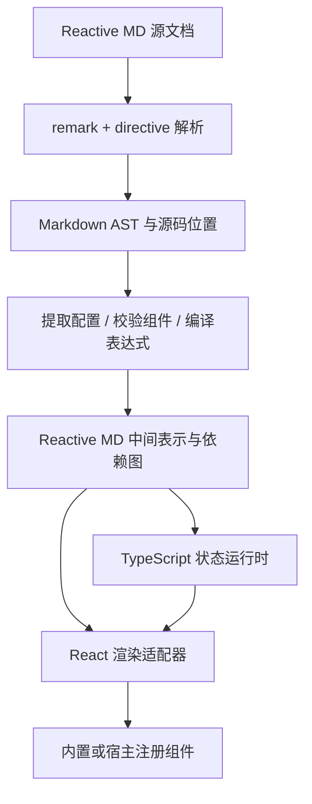

# Reactive MD 语言设计规划

状态：原始 v0.1 设计记录。v0.2 已完成集合状态、宿主异步动作、44 个组件、持久化、流式会话和嵌入库；当前语法以 [语言参考](language-reference.md) 和 [组件参考](components.md) 为准。本文保留最初的取舍与分阶段规划，实施结果见 [实现与验证](demo-implementation.md)。

Reactive MD 让作者在 Markdown 中声明状态、放置交互组件，并写出它们之间的关系。读者调整输入后，相关数值、提示和内容立即更新。语言实现采用 TypeScript，普通 Markdown 交给成熟解析器处理，项目重点放在组件契约、状态更新和渲染运行时。

建议首先面向浏览器中的交互文档、聊天卡片、计算器和简单选择工具。作者编写 Markdown、少量 YAML 和公式；组件开发者通过 TypeScript 扩展组件；宿主应用负责主题、外部服务和权限。

OpenAI 的公开 ChatKit 文档展示了对话内交互卡片，以及组件事件连接客户端或服务端动作的方式。本设计借鉴这一交互方向，单独定义 Reactive MD 的语言与本地状态模型。[ChatKit widgets](https://developers.openai.com/api/docs/guides/chatkit-widgets)、[ChatKit actions](https://developers.openai.com/api/docs/guides/chatkit-actions)。

## 1. 核心选择

| 问题 | 建议 | 原因与代价 |
| --- | --- | --- |
| 文档结构 | 标准 Markdown + directive 指令 | 正文仍容易阅读；作者需要学习冒号和属性语法 |
| 状态定义 | 一个 `reactive-md` 围栏代码块，内容为 YAML | 与普通 frontmatter 分开；复杂文档的配置与正文存在距离 |
| 状态更新 | 输入绑定 + 命名动作 | 常见交互无需事件脚本；复杂业务交给宿主 |
| 计算方式 | 有限、纯表达式 | 支持计算和条件判断；不引入完整编程语言 |
| 样式 | 组件默认样式 + 枚举属性 + 宿主主题 | 作者不写 CSS；自由布局受组件能力约束 |
| Markdown 解析 | 首个适配器采用 remark + remark-directive | 复用 Markdown AST 和指令节点；核心运行时不依赖 remark |
| 首个渲染器 | React 适配器 | 便于组合受控组件；语言语义保持框架独立 |
| 文件名 | 推荐 `*.reactive.md` | 保留 Markdown 文件生态与清楚的用途标记 |

两种备选方案有不同用途：MDX/JSX 适合已经会写 React 的开发者，但会把表达式、导入和执行模型带入作者层；整块 YAML/JSON UI 更容易机器校验，但长正文、列表和引用的编写体验较弱。因此采用 directive 组织正文和组件，YAML 只承载状态、常量与动作。

## 2. 作者看到的语言

一个最小交互文档如下：

````markdown
```reactive-md
version: "0.1"
state:
  count: 0
actions:
  increment:
    - set: count
      value: "=count + 1"
  reset:
    - reset: [count]
```

# 计数器

当前数值：:value{value="=count"}。

::button[加一]{on-click="increment"}
::button[重置]{on-click="reset" variant="secondary"}
````

作者需要掌握四个概念：`state` 保存可以变化的值，`computed` 声明计算关系，`bind` 将输入关联到状态，`actions` 描述点击后发生的状态变化。普通段落、标题、图片、表格和代码块继续使用 Markdown。

完整示例另存为 [计数器](../examples/counter.reactive.md) 和 [方案计算器](../examples/pricing.reactive.md)。

## 3. 文档与组件语法

### 3.1 配置块

一个交互文档最多有一个根级 `reactive-md` 围栏代码块，放在正文之前，可位于普通 frontmatter 之后。配置块中的 `version` 必填，未知版本直接给出诊断。没有配置块时仍可渲染普通 Markdown 和不依赖状态的组件。

配置字段固定为 `version`、`data`、`state`、`computed`、`actions`。未知字段报错，避免拼写错误被静默忽略。配置块嵌入列表、引用或组件容器时视为错误；其他语言的围栏代码块和行内代码保持原样。

`data` 是只读 JSON 兼容数据，`state` 是可写状态，`computed` 是命名表达式，`actions` 是命名动作。YAML 使用受限解析配置：拒绝重复键、自定义标签、锚点、别名和合并键；日期按字符串处理；数字必须有限。运行时值只包含 JSON 类型。

所有 `state` 与 `computed` 名称共享一个命名空间，符合 `[A-Za-z_][A-Za-z0-9_]*`，并与保留名 `data`、内置函数名分开。动作使用独立命名空间。

### 3.2 三种指令形态

| 形态 | 示例 | 用途 |
| --- | --- | --- |
| 行内组件 | `:value{value="=total"}` | 数值、徽章等嵌入段落的内容 |
| 单行块组件 | `::slider{bind="seats" label="人数" min="1" max="20"}` | 输入、按钮等独立控件 |
| 容器组件 | `:::card[方案]` 开始，以 `:::` 结束 | 包含 Markdown 或其他组件的区域 |

这些结构直接采用 remark-directive 支持的 text、leaf 和 container directive 节点。组件属性与运行时行为由 Reactive MD 定义。[remark-directive](https://github.com/remarkjs/remark-directive)。

嵌套时，外层容器使用更多冒号，并用相同数量的冒号结束：

```markdown
::::card[费用估算]
::slider{bind="seats" label="人数" min="1" max="20"}

每月合计：:value{value="=total" format="currency" currency="CNY"}。

:::if{when="=seats >= 5"}
你选择了团队方案，可以继续比较年度付款价格。
:::
::::
```

格式化器负责输出标准缩进和冒号数量。交互配置块与组件容器要求显式闭合；解析器在文件末尾自动补全的结构需要结合原始源码识别并报错。实现时必须覆盖容器内代码围栏、嵌套容器、转义符和未闭合输入的解析测试，不能靠正则表达式切分整篇 Markdown。

### 3.3 属性规则

组件名和属性名使用小写 kebab-case，属性值统一使用引号。首版采用以下规则：

| 写法 | 含义 |
| --- | --- |
| `label="人数"` | 字符串字面量 |
| `min="1"` | 按组件 schema 解析为数字 |
| `disabled="false"` | 按 schema 解析为布尔值 |
| `disabled="=seats < 1"` | 表达式结果，必须为布尔值 |
| `bind="seats"` | 可写状态名称，采用组件定义的默认绑定属性 |
| `on-click="reset"` | 命名动作引用 |
| `label="==原价"` | 字面字符串 `=原价` |

仅 schema 标记为可动态绑定的属性识别前导 `=`；其余属性使用自己的规则。`bind`、`on-click`、`id` 和 `variant` 等结构或标识属性均为静态值。表达式结果不进行隐式类型转换。

`[文本]` 的含义由组件定义：按钮为可访问名称，card 为标题，option 为选项标签。标签支持普通文本和强调；交互控件的标签禁止嵌套链接和其他交互控件。容器正文支持正常块级 Markdown。

首版使用 `:value` 在正文显示动态值。这样只需一套 directive 解析规则；`{{ expression }}` 文本插值留待后续评估。

## 4. 状态与响应式语义

### 4.1 数据模型

````markdown
```reactive-md
version: "0.1"
data:
  monthlyPrice: 100
state:
  seats: 2
  annual: false
computed:
  unitPrice: "=annual ? data.monthlyPrice * 0.8 : data.monthlyPrice"
  total: "=seats * unitPrice"
```
````

v0.1 的可写状态限于 `string`、有限 `number` 和 `boolean`，类型由初始值推断并固定。数组与对象先作为 `data` 中的只读数据；可写集合、可空状态和对象路径绑定在 v0.2 扩展。这样首版可完整处理输入、选择、开关、计数和计算，而无需提前定义集合变更语义。

`computed` 必须使用 `=` 表达式，只读，可引用其他计算值。编译器建立依赖图，拒绝未声明名称和循环依赖，并给出循环路径，例如 `a → b → a`。条件表达式的所有分支都计入静态依赖，求值只执行实际分支。

每个文档实例拥有独立状态。首次挂载克隆初始值；组件重新渲染不重置状态。`if` 内容隐藏时卸载子视图，文档状态继续保留。销毁文档实例释放订阅；再次创建实例从初始值开始。首版默认状态保存在内存中。

### 4.2 更新流程


事件按单实例队列顺序处理。每个事件基于最新已提交版本计算；单个事务中只发布一次更新，因此组件不会看到新 `seats` 与旧 `total` 的混合状态。状态值相等时跳过无效提交。

响应式依赖以状态名、计算值名和动态属性为单位记录。首版只重算受影响的计算节点，并通知相关订阅者。运行时与视图层分开，组件卸载后必须移除其订阅。

### 4.3 输入绑定

`bind` 相当于一个受控值与受校验写入通道：`input` 绑定字符串，`number` / `slider` 绑定数字，`toggle` 绑定布尔值，`select` 在 v0.1 绑定字符串。

控件 schema 声明默认绑定属性，例如 `input.value`、`toggle.checked`。同一控件同时声明 `bind` 与对应 `value` / `checked` 时，编译报错。多个控件绑定同一个状态时，共享值必须满足所有已声明的绑定约束；编译器检测可判断的约束冲突，运行时校验每次更新，包括隐藏控件的约束。

文本输入默认在 `input` 时提交，提供静态属性 `commit="blur"`。中文输入法组合输入期间保持控件草稿，到 `compositionend` 再提交。数字框中的空串和 `-` 等编辑中间态也保留为控件草稿；失焦后仍不合法则显示错误，状态维持最后合法值。

`slider` 在合法范围和步长上更新数字。程序动作写入越界值时拒绝事务，并报告约束错误，不静默修正用户声明的值。

## 5. 表达式语言

表达式采用熟悉的算术与条件写法，独立解析为 AST，由 TypeScript 解释器执行。

| 类别 | v0.1 支持 |
| --- | --- |
| 字面量 | 字符串、有限数字、布尔值、`null` |
| 引用 | `seats`、`total`、`data.monthlyPrice`，只读对象使用静态点路径 |
| 数学 | `+ - * / %`、一元 `-`、括号 |
| 比较 | `== != < <= > >=` |
| 逻辑 | `&&`、`||`、`!`，布尔类型，短路求值 |
| 条件 | `condition ? a : b` |
| 纯函数 | `min`、`max`、`round`、`len`、`contains` |

优先级从高到低为：引用/函数调用、括号内表达式、一元运算、乘除余数、加减、大小比较、相等比较、`&&`、`||`、三元条件。三元条件右结合；其余二元操作左结合。

`+` 只接受两个数字或两个字符串；相等比较不做类型转换；顺序比较要求两个数字或两个字符串；逻辑条件必须为布尔值。字符串顺序采用固定的 Unicode 码点顺序。三元表达式的分支允许同类型或该类型与 `null`，目标属性最终仍需接受实际结果类型。除零、缺失字段、越界数据读取和非有限数值产生诊断。

`min` / `max` 接受一个或多个数字；`round(x)` 将半值朝正无穷方向舍入到整数；`len` 接受字符串或数组，字符串按 Unicode 码点计数；`contains` 支持字符串子串和标量数组成员判断。函数调用只允许这些内置名字，参数类型与数量必须通过检查。

不提供赋值、函数定义、方法调用、动态属性访问、导入、循环或宿主全局对象。解释器只访问数据对象自身的字段，拒绝 `__proto__`、`prototype`、`constructor` 等保留路径片段；禁止 `eval` 与 `new Function`。

普通 JavaScript 数字作为首版数值模型；`format="currency"` 只负责显示。需要精确十进制的业务计算应使用整数最小单位或由后续数值扩展处理。

## 6. 声明式动作

首版动作只有 `set` 和 `reset`，可组合成一个事务：

```yaml
actions:
  addSeat:
    - set: seats
      value: "=min(seats + 1, 20)"
  restore:
    - reset: [seats, annual]
```

动作中的每一个 `set.value` 可以是标量字面量，也可以是前导 `=` 的表达式；字符串字面量以 `=` 开头时使用 `==`。同一动作的所有右值都读取触发前的同一状态快照，目标必须互不重复，再一起提交。因此动作列表表达批量赋值，不表达命令式执行顺序。

`reset` 恢复配置块中对应状态的初始值；`reset` 与 `set` 的写入目标同样不能重叠。`computed` 与 `data` 不可成为写入目标。按钮的 `on-click` 只引用动作名，禁止把任意代码作为属性值。

任意赋值、计算或绑定校验失败，则保留整个旧版本，显示与来源组件关联的诊断。动作失败不会留下半更新状态。首版输入通过 `bind` 更新，不再开放 `on-change` 动作链，避免绑定和二次动作之间出现隐式执行顺序。

## 7. 组件系统

### 7.1 v0.1 组件契约

| 组件 | 形态 | 主要属性与约束 |
| --- | --- | --- |
| `value` | 行内 | `value` 必填且可动态；`format=text/number/currency`，货币格式要求 `currency` |
| `badge` | 行内 | 标签必填；`tone=neutral/success/warning` |
| `card` | 容器 | 可选标题；正文为 Markdown 和组件 |
| `stack` | 容器 | 垂直排列，`gap=sm/md/lg`，默认 md |
| `row` | 容器 | 横排并自动换行，`gap=sm/md/lg`，默认 md |
| `input` | 单行块 | `bind`、`label` 必填；可选 `placeholder`、`commit` |
| `number` | 单行块 | 数字绑定、label；可选静态 `min/max/step`，step 必须为正 |
| `slider` | 单行块 | 数字绑定、label；`min/max` 必填，默认 `step=1` |
| `toggle` | 单行块 | 布尔绑定、label |
| `select` | 容器 | 字符串绑定、label；只允许 `option` 子项和空白 |
| `option` | 单行块 | 静态字符串 `value` 与标签；同一 select 内 value 唯一 |
| `button` | 单行块 | 标签、`on-click`；`variant=primary/secondary/quiet`；动态 `disabled` |
| `if` | 容器 | 动态布尔属性 `when`；为真时挂载正文 |

`input`、`number`、`slider`、`toggle`、`select` 的值通过 `bind` 接收，`label` 可以动态。所有输入组件支持动态布尔 `disabled`。首版 number/slider 的约束与 select 的选项均为静态，确保校验规则可提前确定。

`value` 默认使用 text 格式，接受标量或 null；null 显示为空文本，数组与对象需要专门的数据展示组件。number/currency 格式要求数字，采用宿主提供的 locale，未配置时使用 `zh-CN`；currency 使用合法 ISO 4217 货币代码。渲染端与预渲染端必须使用同一 locale。number 的步长以 min 为基点，缺省基点为 0；数值校验需要定义浮点误差容限，避免合法的小数步长被二进制舍入误差拒绝。

`select` 示例：

```markdown
:::select{bind="plan" label="方案"}
::option[基础版]{value="basic"}
::option[专业版]{value="pro"}
:::
```

常见内容继续由 Markdown 表达；组件库专注于交互与必要布局。Tabs、Accordion、Form、Table、Chart 和列表重复渲染放入后续版本，不要求 MVP 同时实现。

### 7.2 扩展组件必须声明的内容

组件注册记录包含：名字、允许的指令形态、属性 schema、动态属性名单、子节点规则、绑定属性与值类型、事件名单、可访问性要求，以及渲染适配器。校验器据此拒绝未知属性、错误嵌套、重复 ID 和不存在的动作引用。

组件接收已求值、已校验的属性，并通过运行时提供的写入或事件接口交互。组件拿不到可任意修改的全局 store。宿主安装的自定义组件属于受信任代码，由宿主审查其网络和副作用；文档只能引用已经注册的组件。

同一份 schema 应用于编译校验、编辑器补全、组件文档和模型生成约束，避免四份组件描述逐渐不一致。

### 7.3 视觉与可访问性

作者用 `variant`、`tone`、`gap` 等语义属性表达意图。首版禁止 `style`、`class`、任意 CSS 和未注册 DOM 属性。主题的颜色、字号、圆角、间距与焦点样式由宿主提供，组件库保证不同组件使用同一套尺度。

`row` 自动换行，卡片默认占满可用宽度；窄屏保持输入标签、错误信息与按钮可读。支持明暗主题、键盘操作、明确的焦点样式和原生控件语义。条件区域消失且焦点位于其中时，将焦点移到触发控件或最近可聚焦的容器位置。

`value` 默认不使用 live region，避免滑块更新导致连续播报；允许宿主或后续显式属性选择需要播报的结果区域。

## 8. TypeScript 架构

### 8.1 编译与运行分层



解析器处理 CommonMark/GFM 的正文规则与 directive 边界；语言编译器处理 YAML、类型、绑定、表达式和诊断。交互结束后的状态更新直接驱动已编译节点，普通操作不重新解析 Markdown。

建议起步结构如下。这里的包名是工作区目录规划，发布名称另行检查。

```text
packages/
  core/              # 中间表示、表达式 AST、schema、诊断与编译契约
  parser-remark/     # Markdown AST 到中间表示的适配器
  runtime/           # 状态、依赖图、事务、订阅和销毁
  react/             # 中间表示到 React，管理运行时订阅
  components/        # 默认组件、主题和可访问性行为
examples/            # 语言示例与未来验收夹具
docs/                # 规范、设计决策和作者指南
```

先完成一个解析适配器。后续若接入 markdown-it，它也必须生成同一中间表示并通过语义夹具，不在 runtime 内混用两套 AST。

### 8.2 接口草图

以下 TypeScript 只表达边界，不作为当前已经实现的 API：

```ts
type Json = null | boolean | number | string | Json[] | { [key: string]: Json };
type StateValue = boolean | number | string;

interface SourceRange {
  start: number; // 原始文档 UTF-16 offset，含起点
  end: number;   // 不含终点
}

interface Diagnostic {
  code: string;
  message: string;
  severity: "error" | "warning";
  range: SourceRange;
}

type ValueSource =
  | { kind: "literal"; value: Json }
  | { kind: "expression"; expressionId: string };

interface ComponentNode {
  kind: "component";
  id: string;
  name: string;
  props: Record<string, ValueSource>;
  binding?: { state: string; prop: string };
  events: Record<string, string>; // 组件事件 -> 动作名
  children: string[];            // 统一节点表中的子节点 ID
  range: SourceRange;
}

interface RuntimeSnapshot {
  revision: number;
  state: Readonly<Record<string, StateValue>>;
  computed: Readonly<Record<string, Json>>;
}

type DispatchResult =
  | { ok: true; revision: number }
  | { ok: false; diagnostics: readonly Diagnostic[] };

interface Runtime {
  snapshot(): RuntimeSnapshot;
  dispatch(actionName: string): DispatchResult;
  writeBinding(componentId: string, value: StateValue): DispatchResult;
  subscribe(names: readonly string[], listener: () => void): () => void;
  dispose(): void;
}
```

完整 IR 还包括普通 Markdown 节点、动作表、表达式表和依赖索引。所有 ID 和源码位置在编译时生成；文档显式提供的 `id` 优先，普通静态文档可使用编译内 ID。`Readonly` 之外，运行时也必须隔离、冻结或复制对外快照，防止嵌套数据被修改。

编译结果使用成功/失败判别联合：成功包含 IR 与警告，失败包含诊断。无效文档不能创建可交互 runtime。诊断应指向 YAML 字段、表达式片段或组件属性的原始行列，而不只指向转换后的 AST。

## 9. 失败处理与执行边界

| 情况 | 行为 |
| --- | --- |
| 配置重复、未知字段或版本 | 编译失败，标记原始位置 |
| 不存在的组件、属性、状态或动作 | 编译失败，并给出相近名称建议 |
| 不合法类型、循环计算、非法写入目标 | 编译失败，解释冲突关系 |
| 初始值违反控件约束 | 实例创建失败，明确显示具体约束 |
| 用户输入暂时无效 | 控件保留草稿与错误提示，状态不变 |
| 动作计算或校验失败 | 回滚该事务，保留旧状态并报告来源 |
| 自定义渲染组件异常 | 隔离到组件边界，其余文档继续显示 |
| 普通 Markdown 查看器打开文件 | 显示源指令和配置代码块；不承诺具备交互 |

预览工具可以用错误占位符继续显示正文；发布模式在编译错误时拒绝激活交互。原始 HTML 按文本展示或由宿主显式配置的清洗流程处理，默认不执行。链接与图片资源由宿主校验协议和来源，拒绝脚本协议；运行值以文本/受控属性渲染，不重新解释为 HTML 或 Markdown。

解释器对 AST 节点数、求值步数、表达式深度与字符串/数组长度设预算；编译器对文档长度和组件数量设预算，超限返回诊断。默认数值在原型基准后确定，并由宿主配置。预算是实现验收项，不把无限规模支持写进语言契约。

## 10. 面向智能界面的扩展路线

### 10.1 v0.2：组合与数据展示

增加可空/集合状态的显式 schema、只读 `each` 列表作用域、表单校验和 Tabs 等复合组件。`each` 的 `item` / `index` 为只读局部名称，列表必须有稳定且唯一的 key；组件身份由父实例、列表 key 与节点 ID 共同确定。先定义这些身份与作用域规则，再开放可写列表项目和用户自定义模板。

Table 和 Chart 通过注册的数据属性消费结构化数据，采用内置列、排序、筛选和图表配置。数据变换优先提供明确算子；避免要求作者写回调函数。

### 10.2 v0.3：宿主动作与异步资源

外部调用通过宿主注册的 capability 名称声明，例如 `catalog.search`。文档声明输入与结果目标，宿主负责实现、鉴权、网络、超时和结果 schema。文档不携带密钥或任意请求代码。

异步资源统一暴露 `idle/pending/success/error`，保存 `requestId`、输入快照和文档 revision。读取请求默认采用 latest-wins：旧请求可以取消，过期响应不得覆盖新结果。写操作单独定义重复提交策略与服务端幂等标识，不能套用读取请求的丢弃策略。

本地状态事务和远程副作用采用不同完成模型。外部操作不会因重新渲染、计算值变化或文档解析而自动触发，只能由明确事件启动；文档销毁后丢弃回调，支持取消时通知宿主取消。

本节定义设计方向，异步动作的具体 YAML 语法在实现 v0.3 前单独形成规范。

### 10.3 模型生成与流式文档

宿主可向模型提供组件 schema 和示例，校验生成结果后再显示。返回的诊断包含错误码、位置和允许值，便于模型修复源文档。

v0.1 只激活完整编译成功的文档。未来流式模式需要独立的文档提交协议：完整块到达后提交；未闭合内容先显示为文本或占位符；重新解析不触发动作。更新已交互文档时，只有显式稳定 ID、相同状态类型和兼容 schema 才可保留旧值，且保留值需重新校验。输入变化冲突必须通过宿主明确的替换/保留策略处理，不能靠每次重新初始化解决。

## 11. 实施顺序与验收

| 阶段 | 交付结果 | 进入下一阶段的条件 |
| --- | --- | --- |
| 1. 固定语言夹具 | 两个现有示例、有效/无效语法样本、组件 schema 草案 | 属性、表达式、动作和错误行为均能从规范唯一确定 |
| 2. 编译器 | remark 适配器、YAML 校验、表达式 AST、IR、源码诊断 | 普通 Markdown 保留；绑定/类型/循环错误能定位 |
| 3. 运行时 | 状态实例、依赖图、事务、订阅、销毁 | 无 DOM 环境下通过快照隔离、回滚和更新顺序测试 |
| 4. 交互组件 | React 适配器、v0.1 组件与主题 | 两个示例交互完成，键盘与移动布局通过检查 |
| 5. 作者工具 | 预览入口、错误面板、格式化与作者说明 | 新作者能够从示例改出一个计算器，无需 JS/CSS |

MVP 的完成条件：

1. 计数器连续点击三次显示 3，重置后显示 0；另一个文档实例不受影响。
2. 方案计算器初始显示 200 元；开启年度付款后显示 160 元；人数改为 5 后显示 400 元并出现团队提示；恢复后回到初始状态。
3. 一个动作修改多个状态时只通知一次最终版本；任意失败不改变 revision 和任何状态。
4. 循环 computed、未知状态、越界值、重复配置与未知组件都产生有位置的诊断。
5. 输入法组合输入、数字编辑中间态、条件区域卸载与订阅释放均按本文规则工作。
6. 公式或显示值中的 HTML、脚本字符串及原型路径无法获得执行能力；深度与规模限制能够中断超预算输入。
7. 代码围栏、引用、GFM 表格与嵌套指令的解析有固定夹具；代码示例中的指令不会被激活。
8. 在 375px 与桌面宽度检查控件、标签、错误和换行；完成键盘路径与可访问名称检查。

性能阶段记录解析耗时、单次交互耗时和实际重算节点数，注明设备及文档规模。先验证依赖更新不会重解析整篇文档，再依据实测制定延迟目标。

当前可以按上述默认选择开始语法原型。实施前需要评审的主要契约是 directive 外观、命名动作的快照语义、首版标量状态范围和组件目录；宿主服务、持久化与流式更新可按版本分别推进。
