# SCI-FI / SF-01 — Reactive MD 科幻主题

以 Reactive MD 主题包形式提供的硬科幻设计系统。包含三层 design tokens、亮色与暗色模式，以及面板、表格、表单、导航、图表、代码和反馈组件的完整样式。

视觉语言偏工程化：直角模块、1px 结构边框、2px 信号线、等宽字体标签、冷中性色底和单一青色强调色。圆润几何、柔和阴影和消费级色块在 token 层即被移除。

**中文** · [English](README.md) · [设计系统规范](docs/design-system-ch.md)

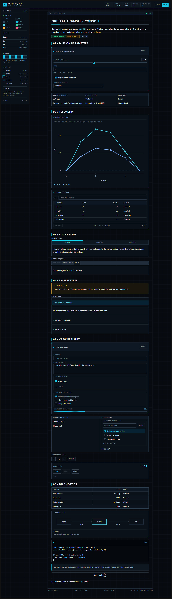

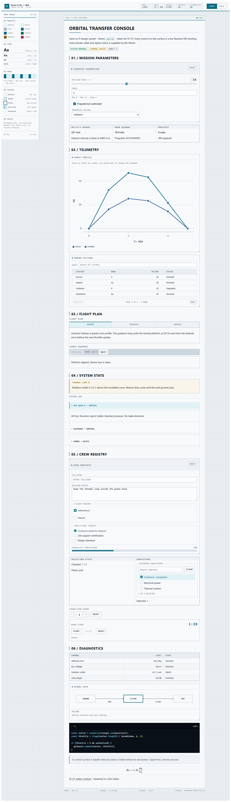

## 包含内容

| 资源 | 路径 | 作用 |
| --- | --- | --- |
| 三层 tokens | `src/tokens.css` | 亮暗两套语义与组件变量 |
| 组件层 | `src/components.css` | 覆盖 Reactive MD 的 `.md-*` / `.local-*` 组件 |
| 直接引入样式表 | `src/sci-fi.css` | 依次引入上述两层 |
| 主题包 | `src/theme.ts` | 通过 `defineLocalTheme` 校验、作用域化并冻结资源 |
| 现场示例文档 | `demo/document.reactive.md` | 用控制台式文档覆盖全部组件族 |
| 示例宿主 | `demo/main.tsx`、`demo/demo.css` | 在文档根之外复用同一套 tokens |
| 设计规范 | `docs/design-system.md` | token 表、组件契约、状态模型与可访问性 |
| 截图 | `screenshots/` | 暗色、亮色、组件特写与 390px 布局 |

这是一个参考主题包，不属于内置的 `default` 主题。宿主注册后，文档通过 `<theme name="sci-fi">` 选择。

## 快速开始

```tsx
import { LOCAL_THEME_PROTOCOL, type LocalThemeDefinition } from 'reactive-md';
import { LocalReactiveDocument } from 'reactive-md/react';
import 'reactive-md/styles.css';
import './tokens.css';
import './components.css';

const sciFi = {
  name: 'sci-fi',
  protocol: LOCAL_THEME_PROTOCOL,
  colorSchemes: ['light', 'dark'],
} as const satisfies LocalThemeDefinition;

<LocalReactiveDocument
  source={source}
  themes={[sciFi]}
  colorScheme="dark"
/>
```

```markdown
<theme name="sci-fi">

# 轨道转移控制台
```

也可以直接使用已校验的主题包：

```ts
import { sciFiTheme, sciFiThemeResources } from './src/theme';
```

`defineLocalTheme` 会拒绝网络资源和宿主全局选择器，并把所有规则限定到 `[data-rmd-theme="sci-fi"]`。源 CSS 本身已按该作用域编写，因此直接引入与主题包注册的效果一致。

## Token 摘要

| 层级 | 示例 |
| --- | --- |
| 原始层 | `--sf-neutral-950`、`--sf-cyan-700`、`--sf-radius-1`、`--sf-type-label` |
| 语义层 | `--surface`、`--ink`、`--line`、`--accent`、`--accent-text`、`--focus`、`--chart-1` |
| 组件层 | `--sf-panel-head-bg`、`--sf-table-head-bg`、`--sf-field-border`、`--sf-nav-active-bg`、`--sf-chart-frame` |

核心约定：

- 圆角默认 `0px`，微型标记 `2px`，上限 `4px`。
- 间距基数为 4px：`4 / 8 / 12 / 16 / 24 / 32 / 48`。
- 控件高度：28 / 34 / 40px。
- 边框：1px 结构线，2px 信号线。
- 高度表达：仅使用 1px 环，不使用模糊投影。
- 字体：正文一套无衬线，机器文本一套等宽。
- 亮暗两种模式都定义完整语义 token；对比度下限由测试保证。

## 组件覆盖

| 类别 | 组件 |
| --- | --- |
| 结构 | 文档表面、面板、卡片、网格矩阵、section |
| 数据 | Markdown 表格、增强表格、图表、函数曲线、关系图、时间线 |
| 表单 | 输入框、多行文本、数字、下拉、滑块、区间、开关、复选、单选、选项卡片、清单、多选、计数器、计时器 |
| 操作 | 主按钮、次按钮、静默按钮、面板重置、复制控件 |
| 导航 | 选项卡、步骤、折叠面板、disclosure、锚点、跳转 |
| 反馈 | 徽标、提示块、进度、错误、校验提示、tooltip |
| 代码 | 围栏代码块、行内代码、展示公式 |

组件结构、状态表和用法见[设计系统规范](docs/design-system.md)。

## 截图

| 组件 | 暗色 | 亮色 |
| --- | --- | --- |
| 参数面板 | 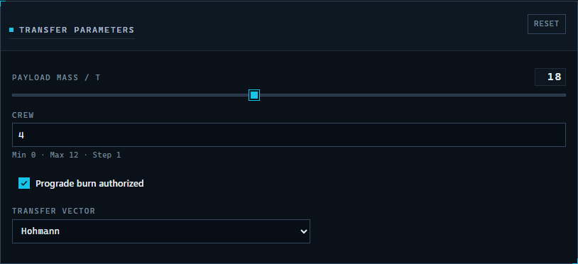 | 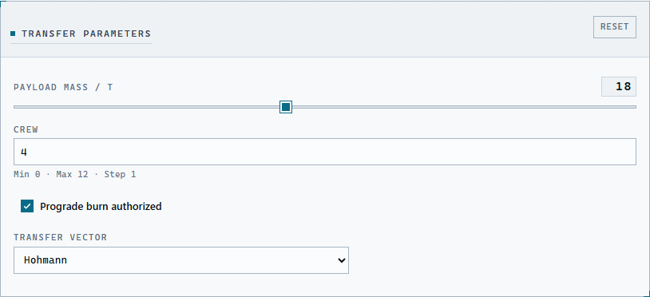 |
| 图表容器 | 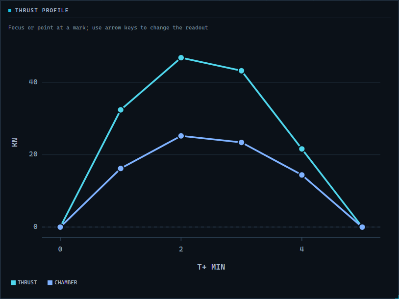 | 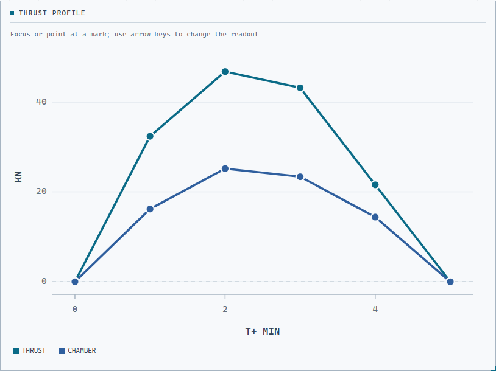 |
| 导航 | 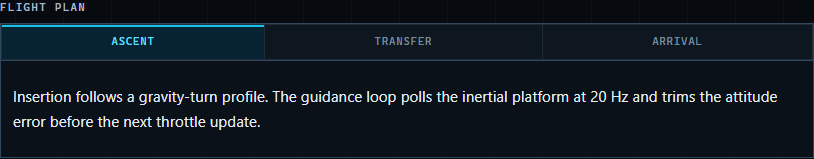 | |
| 表格 | 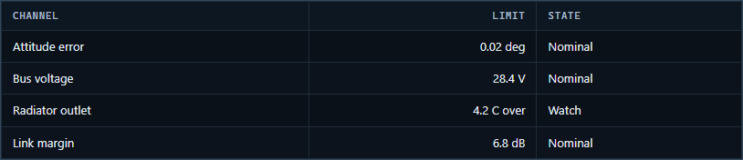 | |
| 增强表格 | 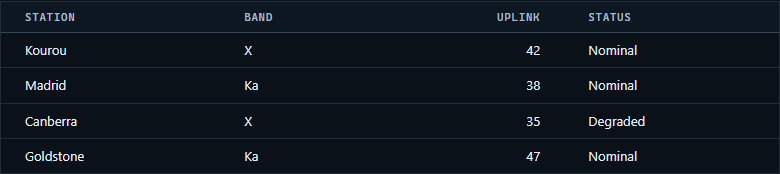 | |
| 关系图 | 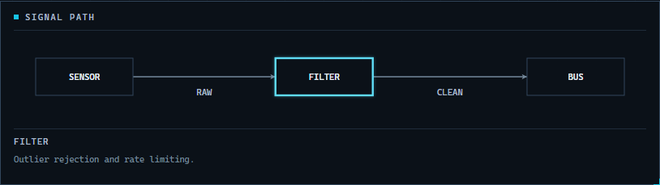 | |
| 移动端 390px | 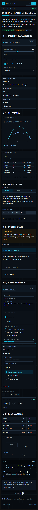 | |

## 运行示例

在仓库根目录执行：

```sh
npm run sci-fi:dev          # Vite 开发服务器 http://127.0.0.1:4317
npm run sci-fi:build        # 构建到 examples/sci-fi-theme/dist
npm run sci-fi:test         # token、作用域、对比度、圆角与间距检查
npm run sci-fi:screenshot   # 重新生成截图；出现运行时错误时失败
```

示例通过 Vite alias 直接引用仓库源码中的 `reactive-md`，开发主题时无需先构建发布包。

## 设计说明

- 亮色是冷纸张控制台，暗色是主要仪表模式。
- 代码块在两种模式下都保持深色，作为终端模块。
- 选中态使用 accent-soft 填充加 2px 内嵌信号线；悬停只改描边；焦点用 2px 外框；禁用态使用 45° 斜线。
- 面板和图表容器带 8px 角标；卡片与表格通过 1px 缝隙共享边线。
- 等宽大写只用于标签、元数据、导航和数值，正文保持无衬线与正常大小写。

## 许可

MIT，与主仓库一致。
