# SCI-FI / SF-01 — Reactive MD theme

A hard-sci-fi design system packaged as a Reactive MD theme. It supplies a
three-layer token set, light and dark modes, and component styling for panels,
tables, forms, navigation, charts, code and feedback surfaces.

The visual language is engineered rather than decorative: rectilinear modules,
1px structural rules, 2px signal lines, mono machine labels, a cold neutral
palette and one cyan accent. Soft elevation, pill geometry and consumer-style
colour washes are removed at the token level.

**English** · [中文](README-ch.md) · [Design system specification](docs/design-system.md)

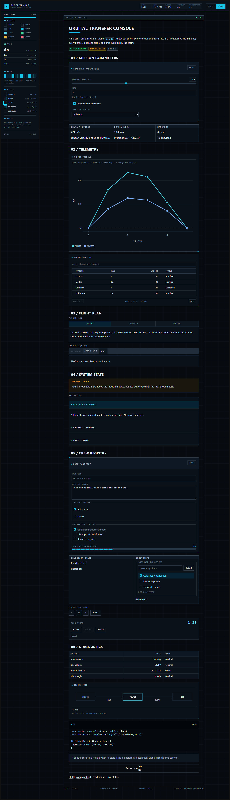

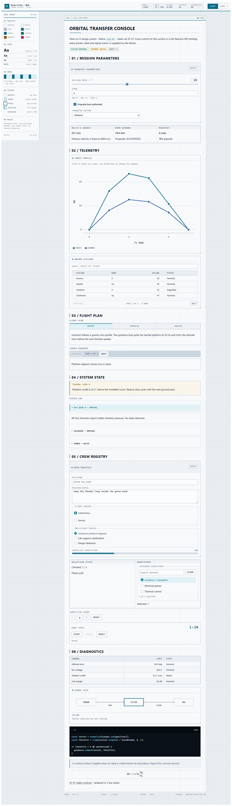

## What is included

| Asset | Path | Purpose |
| --- | --- | --- |
| Primitive + semantic + component tokens | `src/tokens.css` | Light and dark contract for every surface, state and component family |
| Component layer | `src/components.css` | Styling for the Reactive MD `.md-*` and `.local-*` component set |
| Direct-import stylesheet | `src/sci-fi.css` | Convenience entry that imports both layers |
| Registered theme package | `src/theme.ts` | `defineLocalTheme` validation, scoping and frozen resources |
| Live gallery source | `demo/document.reactive.md` | A control-console document exercising every component family |
| Gallery host | `demo/main.tsx`, `demo/demo.css` | Reuses the same tokens outside the document root |
| Design specification | `docs/design-system.md` | Token tables, component contracts, state model and accessibility |
| Screenshots | `screenshots/` | Dark, light, close-ups and 390px layout |

This is a reference package, not part of the built-in `default` theme. The host
registers it and the document selects it with `<theme name="sci-fi">`.

## Quick start

```tsx
import { LOCAL_THEME_PROTOCOL, type LocalThemeDefinition } from 'reactive-md';
import { LocalReactiveDocument } from 'reactive-md/react';
import 'reactive-md/styles.css';
import './tokens.css';
import './components.css';

const sciFi = {
  name: 'sci-fi',
  protocol: LOCAL_THEME_PROTOCOL,
  colorSchemes: ['light', 'dark'],
} as const satisfies LocalThemeDefinition;

<LocalReactiveDocument
  source={source}
  themes={[sciFi]}
  colorScheme="dark"
/>
```

```markdown
<theme name="sci-fi">

# Orbital transfer console
```

Or import the package entry, which validates and scopes the CSS:

```ts
import { sciFiTheme, sciFiThemeResources } from './src/theme';
```

`defineLocalTheme` rejects network resources and host-global selectors and
retargets every rule to `[data-rmd-theme="sci-fi"]`. The original CSS is already
authored against that scope, so direct import and package registration produce
the same result.

## Token summary

| Layer | Examples |
| --- | --- |
| Primitive | `--sf-neutral-950`, `--sf-cyan-700`, `--sf-radius-1`, `--sf-type-label` |
| Semantic | `--surface`, `--ink`, `--line`, `--accent`, `--accent-text`, `--focus`, `--chart-1` |
| Component | `--sf-panel-head-bg`, `--sf-table-head-bg`, `--sf-field-border`, `--sf-nav-active-bg`, `--sf-chart-frame` |

Key contracts:

- Radius: `0px` by default, `2px` for micro marks, `4px` maximum.
- Spacing: 4px unit; `4 / 8 / 12 / 16 / 24 / 32 / 48`.
- Controls: 28 / 34 / 40px heights.
- Borders: 1px structural, 2px signal.
- Elevation: 1px rings only; no blurred shadows.
- Typography: one sans for prose, one mono for machine text.
- Both schemes define every semantic token; contrast floors are tested.

## Component coverage

| Family | Components |
| --- | --- |
| Structure | Document surface, panel, card, grid matrix, section |
| Data | Markdown table, enhanced table, chart, plot, diagram, timeline |
| Forms | Input, textarea, number, select, slider, range, toggle, checkbox, radio, choices, checklist, multi-select, counter, timer |
| Actions | Primary, secondary and quiet buttons, panel reset, copy control |
| Navigation | Tabs, steps, accordion, disclosure, anchors, jumps |
| Feedback | Badges, alerts, progress, errors, validation hints, tooltips |
| Code | Fenced code block, inline code, display math |

See the [design system specification](docs/design-system.md) for anatomy,
state tables and usage rules.

## Screenshots

| Component | Dark | Light |
| --- | --- | --- |
| Mission panel | 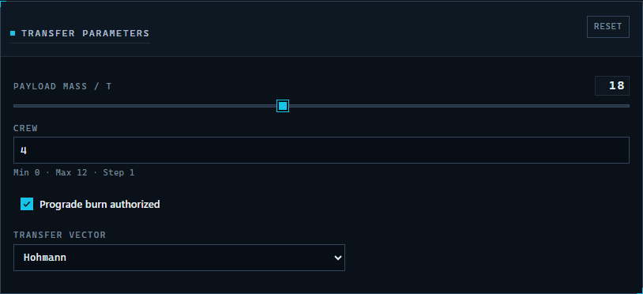 | 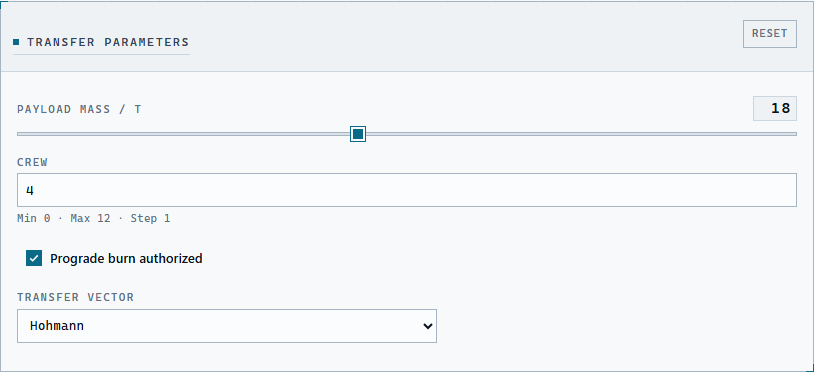 |
| Chart container | 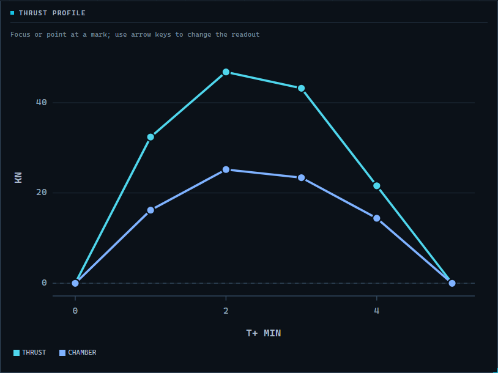 | 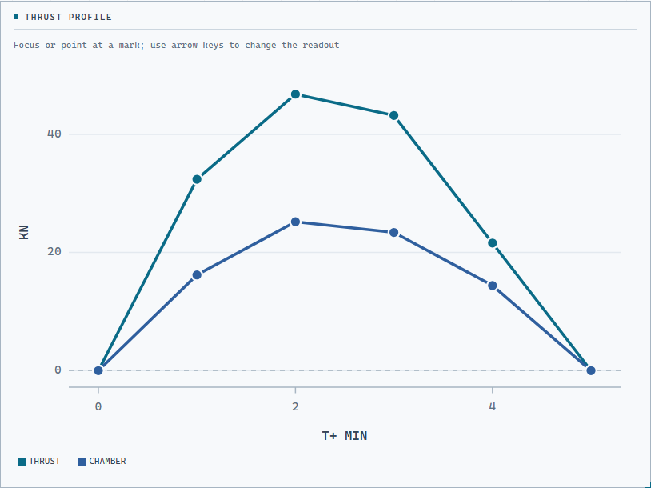 |
| Navigation | 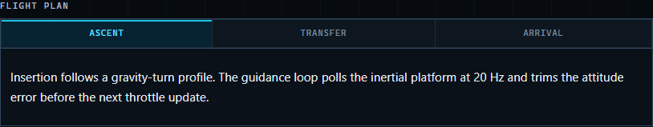 | |
| Table | 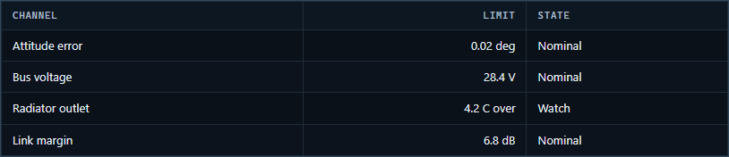 | |
| Enhanced table | 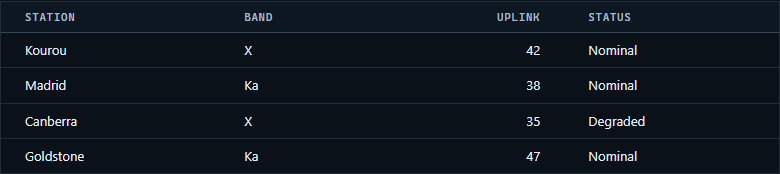 | |
| Diagram | 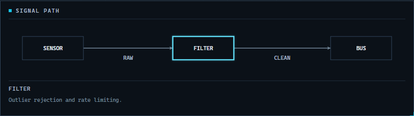 | |
| Mobile 390px | 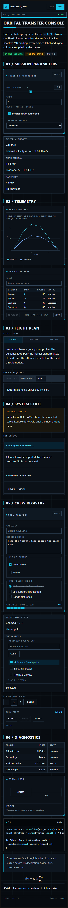 | |

## Run the gallery

From the repository root:

```sh
npm run sci-fi:dev          # Vite dev server on http://127.0.0.1:4317
npm run sci-fi:build        # production build in examples/sci-fi-theme/dist
npm run sci-fi:test         # token, scope, contrast, radius and spacing checks
npm run sci-fi:screenshot   # regenerate screenshots/ and fail on runtime errors
```

The gallery imports `reactive-md` through Vite aliases to the repository source,
so no package build is required while developing the theme.

## Design notes

- The light scheme is a cold paper console; the dark scheme is the primary
  instrument mode.
- Code blocks stay dark in both schemes as a terminal module.
- Selected states use accent-soft fill plus a 2px inset signal line. Hover uses
  stroke only. Focus uses a 2px outline. Disabled uses a 45° hatch.
- Panels and chart frames carry 8px corner ticks; cards and tables share edges
  through 1px gutters.
- Mono uppercase is limited to labels, metadata, navigation and numeric values.
  Prose remains sans and sentence case.

## License

MIT, matching the repository.
